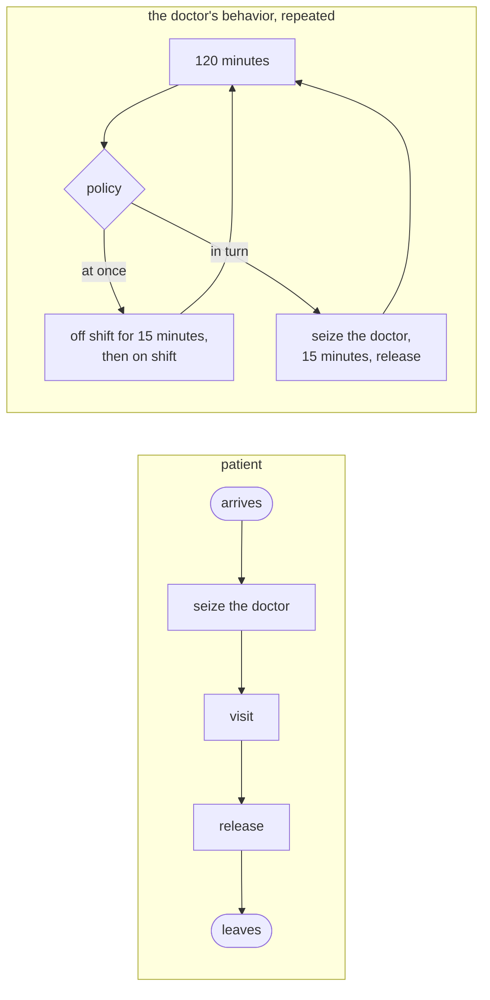
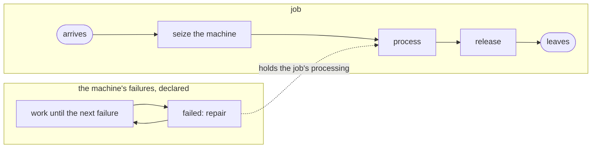
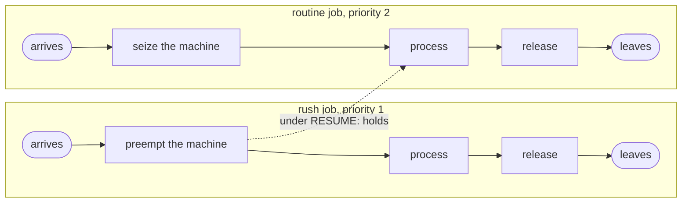
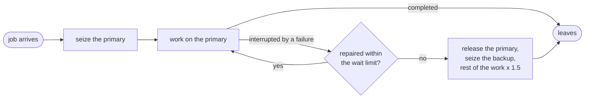

# Breaks, breakdowns and urgent work — a tutorial through the examples

*Four worked cases.* Each one states a **problem**, describes the **system** with a table of every
distribution and parameter, draws the **model**, gives **the whole of its code** with an explanation of
every part, shows what it **produced**, and says **how we know it is right**: each example is checked
against an answer found some other way, either the exact result of a queueing model or the same system
written another way. Every number on this page came from running the example named beside it.

**New in R1.9.**

> **Status: experimental.** A resource's own behavior (`behavior`, `cyclicBehavior`, `goOffShift`,
> `goOnShift`), failures and repairs (`failures`, `fail`, `repair`), preemption (`preempt`), and reacting
> to them (`delayOrInterrupt`, an allocation's `interruptedTrigger` and `restoredTrigger`, a delay's
> `uses`) are released as experimental until the textbook covers them. Their API may change in a future
> release.

This page assumes you can read a process model: an entity, its `process { … }`, `seize`, `delay` and
`release`, as in the textbook's chapter 6. Case 4 also uses `waitForFirst` with a time limit, the subject
of the [waits tutorial](ksl-waits-tutorial.md). The reference for every function used here is
[`ksl-entity`](ksl-entity.md), sections "...give a resource its own behavior", "...fail and repair a
resource", "...let urgent work take a resource (preemption)" and "...react to a failure or preemption".

---

## How to read this tutorial

A resource is not always there to be seized. A doctor takes breaks, a machine breaks down, and urgent work
takes a machine from the job on it. Until R1.9 a model could change a resource's capacity on a timetable,
but the resource could not act for itself, could not fail, and could not be taken from its holder. The
cases below take a resource away in each of these ways, and the last lets the job that loses it decide
what to do.

| # | Case | What it teaches | Run it with |
|---|---|---|---|
| 1 | [A doctor's breaks](#1-a-doctors-breaks) | a resource's own behavior; a break that cuts in and one that waits its turn; the same breaks by a schedule | `:KSLExamples:clinicBreaks` |
| 2 | [A machine that breaks down](#2-a-machine-that-breaks-down) | declared failures and repairs; what happens to the job on the machine; counting failures by busy time, calendar time or uses | `:KSLExamples:machineBreakdowns` |
| 3 | [Rush orders](#3-rush-orders) | a job that takes the machine from a less urgent one; preemption that resumes, and preemption that waits for the job to finish | `:KSLExamples:rushOrders` |
| 4 | [Rerouting around a failure](#4-rerouting-around-a-failure) | a job told of the failure, which waits a while for the repair and then moves to a backup machine | `:KSLExamples:rerouting` |

The examples are in `KSLExamples/src/main/kotlin/ksl/examples/general/processview/resources/`. Each has a
`main`; from IntelliJ, run it with the green arrow beside it, or from the command line with the Gradle task
in the table.

**Reading the code.** Each case gives its example **in full**, apart from the license header, the import
list and the file's own documentation comments, which this page replaces. The code is split into numbered
parts, each followed by what it does and why.

**Reading the numbers.** Every model here runs 20 replications from fixed random number streams, so
running an example gives exactly the numbers on this page. Where an estimate is compared with an exact
value, the comparison is a 99% confidence interval from the replications, and the question is whether the
exact value lies inside it. Where two formulations of one system are compared, they draw the same random
numbers in the same order, and the question is whether every result is *identical*: not close, the same.
Where several versions of a system are compared with one another, they run on common random numbers, and
each difference from the first comes with the half-width of its own 95% confidence interval, from the
differences replication by replication.

`ResourcesExamplesValidationTest` in `KSLExamples/src/test` repeats every one of these checks on each
build.

---

## 1. A doctor's breaks

### The problem

A walk-in clinic has one doctor, who takes a 15-minute break every two hours. The clinic wants to know what
the breaks cost its patients in waiting, and whether it matters how the doctor takes them: at the set time,
leaving the waiting room to wait, or when the patients who came first have been seen.

### The system

Patients arrive at random, one every 6 minutes on average, and are seen in order of arrival. A visit lasts
4 minutes on average. The doctor is busy two-thirds of the time.

| Quantity | Distribution or value | Model element |
|---|---|---|
| Time between patients | exponential, mean 6 minutes | `TimeBetweenArrivals` |
| Visit length | exponential, mean 4 minutes | `ServiceTime` |
| Doctors | 1 | `Doctor` |
| Time between breaks | 120 minutes | `timeBetweenBreaks` |
| Length of a break | 15 minutes | `breakLength` |
| Replications | 20 of 50,000 minutes, after a warm-up of 5,000 | |

Without breaks, this is the M/M/1 queue, whose answers are known exactly: with λ = 1/6 and μ = 1/4 a
minute, the doctor is busy ρ = λ/μ = 2/3 of the time, a patient waits ρ/(μ − λ) = 8 minutes on average,
and ρ²/(1 − ρ) = 4/3 patients are waiting.

The doctor takes a break in one of two ways:

- **at once:** at the set time, no new patient is called in until the break is over; a patient already
  with the doctor is seen to the end;
- **in turn:** at the set time the break joins the patients' queue, and starts when the doctor reaches it.

### The model



*Figure 1 — the patient's process and the doctor's own. A third version makes the at-once breaks with a
capacity schedule instead of a behavior.*

### The code

`ClinicBreaks.kt` in full.

#### 1. The break policies

```kotlin
enum class BreakPolicy {
    /** At the set time: no patient starts until the break is over, but the one being seen is finished. */
    AT_ONCE,

    /** The same breaks as [AT_ONCE], made by a capacity schedule instead of a behavior. */
    AT_ONCE_BY_SCHEDULE,

    /** In turn: the break joins the patients' queue at the set time and starts when the doctor is free for it. */
    IN_TURN
}
```

`AT_ONCE_BY_SCHEDULE` is the same breaks as `AT_ONCE`, made the way the KSL made them before R1.9. It is
here to check the new way against the old.

#### 2. The clinic's parameters and its elements

```kotlin
class ClinicWithBreaks(
    parent: ModelElement,
    val arrivalRate: Double = 1.0 / 6.0,
    val meanServiceTime: Double = 4.0,
    val timeBetweenBreaks: Double = 120.0,
    val breakLength: Double = 15.0,
    val policy: BreakPolicy = BreakPolicy.AT_ONCE,
    name: String? = null
) : ProcessModel(parent, name) {

    private val arrivals = RandomVariable(this, ExponentialRV(1.0 / arrivalRate, 1), "TimeBetweenArrivals")
    private val service = RandomVariable(this, ExponentialRV(meanServiceTime, 2), "ServiceTime")

    val doctor: ResourceWithQ = ResourceWithQ(this, name = "Doctor")

    val patientWait = Response(this, "PatientWait")
    val timeInClinic = Response(this, "TimeInClinic")
    private val breaksTaken = Counter(this, "BreaksTaken")
    val breakLateBy = Response(this, "BreakLateBy")
```

The constructor takes every parameter of the table above as a default, so `ClinicWithBreaks(model)` builds
the clinic as described. `BreaksTaken` counts breaks, and `BreakLateBy` records, for breaks taken in turn,
how long after the set time each one started.

#### 3. The breaks

```kotlin
init {
    when (policy) {
        BreakPolicy.AT_ONCE -> doctor.cyclicBehavior {
            delay(timeBetweenBreaks)
            doctor.goOffShift()
            breaksTaken.increment()
            delay(breakLength)
            doctor.goOnShift()
        }
        BreakPolicy.AT_ONCE_BY_SCHEDULE -> {
            val schedule = CapacitySchedule(this, startTime = 0.0, autoStartOption = true, repeatable = true)
            schedule.addItem(capacity = 1, duration = timeBetweenBreaks)
            schedule.addItem(capacity = 0, duration = breakLength)
            doctor.useSchedule(schedule, CapacityChangeRule.IGNORE)
        }
        BreakPolicy.IN_TURN -> doctor.cyclicBehavior {
            delay(timeBetweenBreaks)
            val due = time
            val onBreak = seize(doctor)
            breakLateBy.value = time - due
            breaksTaken.increment()
            delay(breakLength)
            release(onBreak)
        }
    }
}
```

This is the new construct. `cyclicBehavior { … }` gives the doctor a process of its own: the block is one
cycle, and the library repeats it for as long as the replication lasts. Every replication starts the
behavior afresh at time 0, as an entity of the resource's own, and the end of the replication stops it.
Anything a process can do is allowed in the block.

- **At once.** `goOffShift()` drops the doctor's capacity to zero, and `goOnShift()` restores it. Under the
  resource's capacity-change rule, `IGNORE` by default, a patient being seen when the doctor goes off shift
  is seen to the end; no one else is called in until the doctor is back on shift.
- **At once, by a schedule.** A `CapacitySchedule` of capacity 1 for 120 minutes and 0 for 15, repeated,
  does the same with `CapacityChangeRule.IGNORE`. A resource takes its capacity from a schedule or from its
  own shifts, not both: a resource with a schedule refuses `goOffShift`.
- **In turn.** The break is a seize of the doctor by the doctor's own behavior. It joins the queue behind
  the patients already waiting, and the doctor is busy with it for 15 minutes. Nothing new is needed for
  this: the behavior is a process, and a process can seize.

#### 4. The patients

```kotlin
    private inner class Patient : Entity() {
        val visit: KSLProcess = process {
            val a = seize(doctor)
            patientWait.value = time - createTime
            delay(service)
            release(a)
            timeInClinic.value = time - createTime
        }
    }

    override fun initialize() {
        schedule(::arrival, arrivals)
    }

    private fun arrival(event: KSLEvent<Nothing>) {
        activate(Patient().visit)
        schedule(::arrival, arrivals)
    }
}
```

The patient's process does not mention breaks. Whatever the doctor does, a patient seizes, is seen, and
releases.

#### 5. The check against M/M/1

```kotlin
fun main() {
    println("No breaks, against the exact M/M/1 answers")
    val plain = Model("ClinicBreaks", autoCSVReports = false)
    val noBreaks = ClinicWithBreaks(plain, name = "Clinic")
    plain.controls().control("Doctor.behaviorActiveAtStart")!!.value = 0.0
    plain.numberOfReplications = 20
    plain.lengthOfReplication = 50_000.0
    plain.lengthOfReplicationWarmUp = 5_000.0
    plain.simulate()
    val lambda = noBreaks.arrivalRate
    val mu = 1.0 / noBreaks.meanServiceTime
    val rho = lambda / mu
    val exact = mapOf(
        "PatientWait" to rho / (mu - lambda),
        "Doctor:Q:NumInQ" to rho * rho / (1.0 - rho),
        "Doctor:NumBusyUnits" to rho
    )
    val statistics = plain.responses.associate { it.name to it.acrossReplicationStatistic }
    println(String.format("%-18s %10s %22s %10s", "", "estimate", "99% interval", "exact"))
    for ((name, value) in exact) {
        val s = statistics.getValue(name)
        val ci = s.confidenceInterval(0.99)
        println(String.format("%-18s %10.4f   [%8.4f, %8.4f] %10.4f", name, s.average, ci.lowerLimit, ci.upperLimit, value))
    }
```

A resource with a behavior has the control `behaviorActiveAtStart`, true by default. Setting it to 0 (false)
before the run means no replication starts the behavior, so the clinic is the M/M/1 queue with nothing else
changed. An experiment can compare a model with and without its behavior the same way, without changing
the model's code.

#### 6. The comparison

```kotlin
    println()
    println("A 15-minute break every 120 minutes, on common random numbers, against no breaks")
    val cases = listOf<Pair<String, BreakPolicy?>>(
        "no breaks" to null,
        "at once" to BreakPolicy.AT_ONCE,
        "at once, scheduled" to BreakPolicy.AT_ONCE_BY_SCHEDULE,
        "in turn" to BreakPolicy.IN_TURN,
    )
    val results = cases.map { (label, policy) ->
        val m = Model("ClinicBreaks", autoCSVReports = false)
        ClinicWithBreaks(m, policy = policy ?: BreakPolicy.AT_ONCE, name = "Clinic")
        if (policy == null) m.controls().control("Doctor.behaviorActiveAtStart")!!.value = 0.0
        m.numberOfReplications = 20
        m.lengthOfReplication = 50_000.0
        m.lengthOfReplicationWarmUp = 5_000.0
        val collector = ReplicationDataCollector(m)
        collector.addResponse("PatientWait")
        collector.addResponse("Doctor:NumBusyUnits")
        m.simulate()
        label to collector
    }
    val base = results.first().second.replicationData("PatientWait")
    println(String.format("%-20s %10s %10s %12s %10s %10s", "", "wait", "half-width", "difference", "half-width", "busy"))
    for ((label, collector) in results) {
        val data = collector.replicationData("PatientWait")
        val s = Statistic(data)
        val d = Statistic(DoubleArray(data.size) { data[it] - base[it] })
        val busy = Statistic(collector.replicationData("Doctor:NumBusyUnits")).average
        println(String.format("%-20s %10.3f %10.3f %12.3f %10.3f %10.4f", label, s.average, s.halfWidth, d.average, d.halfWidth, busy))
    }
    println()
    println("Read this alongside docs/guides/ksl-resources-tutorial.md, case 1.")
}
```

Four clinics run on common random numbers: the same patients, arriving at the same times and needing the
same visits. Each one's mean wait is set beside the difference from the clinic without breaks.

### What it shows

```text
No breaks, against the exact M/M/1 answers
                     estimate           99% interval      exact
PatientWait            8.0122   [  7.5234,   8.5010]     8.0000
Doctor:Q:NumInQ        1.3358   [  1.2487,   1.4228]     1.3333
Doctor:NumBusyUnits     0.6675   [  0.6595,   0.6755]     0.6667
A 15-minute break every 120 minutes, on common random numbers, against no breaks
                           wait half-width   difference half-width       busy
no breaks                 8.012      0.358        0.000      0.000     0.6675
at once                  12.547      0.600        4.535      0.275     0.6675
at once, scheduled       12.547      0.600        4.535      0.275     0.6675
in turn                  13.067      0.613        5.054      0.272     0.7717
```

### How we know it is right

Without breaks, the three exact values lie inside their intervals: turning the behavior off by its control
leaves exactly an M/M/1 queue. With breaks taken at once, the behavior and the schedule give the same
results to every digit printed, and `ResourcesExamplesValidationTest` checks that they are identical in
count, average and variance. Identical results mean each break started and ended at the same moment in both,
and that each patient was called in at the same moment.

### What to learn

**Breaks cost more than their share of the time.** The doctor is away 15 minutes in 135, 11% of the time,
yet the mean wait rises from 8.0 to 12.5 minutes, by more than half: a queue at two-thirds load is
sensitive to any loss of capacity, and the patients who arrive during a break find it already growing.

**How a break is taken matters, and not always as expected.** Breaks taken in turn never leave a patient
mid-visit and never jump the queue, yet they cost more: 5.05 minutes of extra waiting against 4.54, each measured
against the same clinic without breaks. A break taken at once starts while a patient may still be with the doctor,
so part of the break is spent finishing that visit, and the doctor's working time is unchanged: busy 0.6675
in both. A break taken in turn is a seize, so its full 15 minutes are taken from the patients, and counted
as busy time: 0.7717.

**A behavior is a process,** so it can decide when and how to act from the state of the model, which a
timetable cannot. Where a timetable is all that is needed, a schedule is the simpler tool, and gives the
same results.

---

## 2. A machine that breaks down

### The problem

A machine processes jobs one at a time. It breaks down now and then, and is out of action until repaired.
The shop wants to know how long jobs spend in the shop, and how that depends on what a breakdown does to
the job on the machine and on what wears the machine out.

### The system

Jobs arrive at random, one every 12 minutes on average, and are processed in order of arrival for between 5
and 11 minutes. The machine fails after an average of 60 minutes of work and is repaired in 5 minutes on
average. A job interrupted by a failure goes on where it left off when the machine is repaired.

| Quantity | Distribution or value | Model element |
|---|---|---|
| Time between jobs | exponential, mean 12 minutes | `TimeBetweenArrivals` |
| Processing time | uniform, 5 to 11 minutes | `ProcessingTime` |
| Time between failures | exponential, mean 60 minutes of busy time | `Machine:TimeBetweenFailuresRV` |
| Repair time | exponential, mean 5 minutes | `Machine:RepairTimeRV` |
| Job interrupted by a failure | goes on where it left off (`InterruptRule.RESUME`) | `rule` |
| Replications | 20 of 50,000 minutes, after a warm-up of 5,000 | |

The comparison runs four variations of this machine: a job that starts again in full after the repair
(`RESTART`), a job that is finished before the machine stops (`FINISH`), failures counted in calendar time
instead of busy time, and a failure after every 8 jobs.

### The model



*Figure 2 — the job's process and the machine's failures. The job does nothing about a failure: its delay
is held until the repair.*

### The code

`MachineBreakdowns.kt` in full.

#### 1. The shop's parameters, its elements and the failures

```kotlin
class BreakdownShop(
    parent: ModelElement,
    val arrivalRate: Double = 1.0 / 12.0,
    processingTime: RVariableIfc = UniformRV(5.0, 11.0, 2),
    timeBetweenFailures: RVariableIfc = ExponentialRV(60.0, 3),
    repairTime: RVariableIfc = ExponentialRV(5.0, 4),
    val basis: ResourceFailureBasis = ResourceFailureBasis.BUSY_TIME,
    val rule: InterruptRule = InterruptRule.RESUME,
    name: String? = null
) : ProcessModel(parent, name) {

    private val arrivals = RandomVariable(this, ExponentialRV(1.0 / arrivalRate, 1), "TimeBetweenArrivals")
    private val processing = RandomVariable(this, processingTime, "ProcessingTime")

    private val machine: ResourceWithQ = ResourceWithQ(this, name = "Machine")

    init {
        machine.interruptRule = rule
        machine.failures(timeBetween = timeBetweenFailures, repairTime = repairTime, basis = basis)
    }

    val timeInShop = Response(this, "TimeInShop")
    val completionTime = Response(this, "CompletionTime")
    val interruptionsPerJob = Response(this, "InterruptionsPerJob")
```

`failures(timeBetween, repairTime, basis)` declares the machine's failures. From then on the machine
fails and is repaired by itself, every replication, by an entity of its own. The two times become random
variables of the machine, named `Machine:TimeBetweenFailuresRV` and `Machine:RepairTimeRV`, with their
streams managed by the model like any other. Declaring failures also adds two statistics,
`Machine:PTimeFailed` and `Machine:NumFailures`.

The **basis** says what the time between failures counts:

- `BUSY_TIME`, the time the machine is working, so an idle machine does not wear out;
- `CALENDAR_TIME`, simulated time, whether the machine works or not;
- `USES`, the number of jobs: the machine fails at the release that completes them.

The **interrupt rule**, `interruptRule`, says what a failure does to the job on the machine:

- `RESUME`: the job's delay is held, and goes on with the time it had left after the repair;
- `RESTART`: the same, but the delay starts again in full;
- `FINISH`: the job completes, and the machine is kept from the next job until the repair.

While the machine is failed no job can seize it; jobs wait in its queue.

#### 2. The job

```kotlin
    private inner class Job : Entity() {
        val work: KSLProcess = process {
            val a = seize(machine)
            val start = time
            delay(processing)
            completionTime.value = time - start
            interruptionsPerJob.value = a.timesInterrupted.toDouble()
            release(a)
            timeInShop.value = time - createTime
        }
    }

    override fun initialize() {
        schedule(::arrival, arrivals)
    }

    private fun arrival(event: KSLEvent<Nothing>) {
        activate(Job().work)
        schedule(::arrival, arrivals)
    }
}
```

The job's process is the one it would have on a machine that never fails. `CompletionTime` is the time
from the start of processing to its end, repairs included, and `a.timesInterrupted` is how many times the
job's allocation of the machine was interrupted.

#### 3. The exact answers

```kotlin
class MG1WithBreakdowns(
    val arrivalRate: Double,
    val meanProcessing: Double,
    val processingSecondMoment: Double,
    val failureRate: Double,
    val meanRepair: Double,
    val repairSecondMoment: Double
) {
    /** The mean completion time: the processing time stretched by the repairs during it. */
    val meanCompletion: Double = meanProcessing * (1.0 + failureRate * meanRepair)

    /** The second moment of the completion time. */
    val completionSecondMoment: Double =
        processingSecondMoment * (1.0 + failureRate * meanRepair) * (1.0 + failureRate * meanRepair) +
                failureRate * meanProcessing * repairSecondMoment

    /** The utilization, counting repairs during jobs as busy. */
    val rho: Double = arrivalRate * meanCompletion

    init {
        require(rho < 1.0) { "The queue must be stable: rho = $rho" }
    }

    /** The mean wait in queue (Pollaczek-Khinchine). */
    val meanWait: Double = arrivalRate * completionSecondMoment / (2.0 * (1.0 - rho))

    /** The mean time in the shop. */
    val meanTimeInShop: Double = meanWait + meanCompletion

    /** The proportion of time the machine is failed. */
    val probFailed: Double = arrivalRate * meanProcessing * failureRate * meanRepair
}
```

From a job's point of view, a failure only stretches its processing. Failures come at rate f = 1/60 per
minute of work, so a job of length S suffers a Poisson number of failures with mean fS, each adding a
repair R. Its completion time C, processing and repairs together, has

- E[C] = E[S](1 + f E[R]),
- E[C²] = E[S²](1 + f E[R])² + f E[S] E[R²].

The machine is then an M/G/1 queue whose service time is C, and the Pollaczek-Khinchine formula gives the
mean wait, λE[C²] / (2(1 − λE[C])). The machine is failed for λE[S] f E[R] of the time: λE[S] of the
time it is working, and each minute of work brings f E[R] minutes of repair.

This holds because failures are counted in busy time and the time between them is exponential: whatever
work has been done since the last failure, the time to the next is the same. It is not the answer for the
other variations.

#### 4. The check against M/G/1

```kotlin
fun main() {
    val exact = MG1WithBreakdowns(
        arrivalRate = 1.0 / 12.0, meanProcessing = 8.0, processingSecondMoment = 8.0 * 8.0 + 36.0 / 12.0,
        failureRate = 1.0 / 60.0, meanRepair = 5.0, repairSecondMoment = 50.0
    )
    println("Failures every 60 busy minutes on average, the job going on where it left off, against M/G/1")
    val m = Model("Breakdowns", autoCSVReports = false)
    val shop = BreakdownShop(m, name = "Shop")
    m.numberOfReplications = 20
    m.lengthOfReplication = 50_000.0
    m.lengthOfReplicationWarmUp = 5_000.0
    m.simulate()
    val statistics = m.responses.associate { it.name to it.acrossReplicationStatistic }
    println(String.format("%-22s %10s %22s %10s", "", "estimate", "99% interval", "exact"))
    for ((name, value) in listOf(
        "CompletionTime" to exact.meanCompletion,
        "Machine:Q:TimeInQ" to exact.meanWait,
        "TimeInShop" to exact.meanTimeInShop,
        "Machine:PTimeFailed" to exact.probFailed
    )) {
        val s = statistics.getValue(name)
        val ci = s.confidenceInterval(0.99)
        println(String.format("%-22s %10.4f   [%8.4f, %8.4f] %10.4f", name, s.average, ci.lowerLimit, ci.upperLimit, value))
    }
```

With S uniform on 5 to 11, E[S] = 8 and E[S²] = 8² + 6²/12 = 67; with R exponential with mean 5,
E[R²] = 2 × 5² = 50.

#### 5. The comparison

```kotlin
    println()
    println("Other rules and bases, on common random numbers, against the first")
    val configurations = listOf(
        Triple("RESUME, busy time", ResourceFailureBasis.BUSY_TIME, InterruptRule.RESUME),
        Triple("RESTART, busy time", ResourceFailureBasis.BUSY_TIME, InterruptRule.RESTART),
        Triple("FINISH, busy time", ResourceFailureBasis.BUSY_TIME, InterruptRule.FINISH),
        Triple("RESUME, calendar time", ResourceFailureBasis.CALENDAR_TIME, InterruptRule.RESUME),
        Triple("every 8 jobs", ResourceFailureBasis.USES, InterruptRule.RESUME),
    )
    val observations = configurations.map { (label, basis, rule) ->
        val model = Model("Breakdowns", autoCSVReports = false)
        val between = if (basis == ResourceFailureBasis.USES) ConstantRV(8.0) else ExponentialRV(60.0, 3)
        BreakdownShop(model, timeBetweenFailures = between, basis = basis, rule = rule, name = "Shop")
        model.numberOfReplications = 20
        model.lengthOfReplication = 50_000.0
        model.lengthOfReplicationWarmUp = 5_000.0
        val collector = ReplicationDataCollector(model)
        collector.addResponse("TimeInShop")
        collector.addResponse("Machine:PTimeFailed")
        collector.addCounterResponse("Machine:NumFailures")
        model.simulate()
        Triple(label, collector.replicationData("TimeInShop"), collector)
    }
    val base = observations.first().second
    println(String.format("%-22s %10s %10s %12s %10s %10s", "", "TimeInShop", "half-width", "difference", "half-width", "failures"))
    for ((label, data, collector) in observations) {
        val s = Statistic(data)
        val d = Statistic(DoubleArray(data.size) { data[it] - base[it] })
        val failures = Statistic(collector.replicationData("Machine:NumFailures")).average
        println(String.format("%-22s %10.3f %10.3f %12.3f %10.3f %10.1f", label, s.average, s.halfWidth, d.average, d.halfWidth, failures))
    }
    println()
    println("Read this alongside docs/guides/ksl-resources-tutorial.md, case 2.")
}
```

Each variation runs on common random numbers with the first. `ConstantRV(8.0)` with `USES` fails the
machine after exactly every 8 jobs.

### What it shows

```text
Failures every 60 busy minutes on average, the job going on where it left off, against M/G/1
                         estimate           99% interval      exact
CompletionTime             8.6602   [  8.6264,   8.6941]     8.6667
Machine:Q:TimeInQ         12.3055   [ 11.6755,  12.9354]    12.7948
TimeInShop                20.9648   [ 20.3193,  21.6102]    21.4615
Machine:PTimeFailed        0.0548   [  0.0529,   0.0566]     0.0556
Other rules and bases, on common random numbers, against the first
                       TimeInShop half-width   difference half-width   failures
RESUME, busy time          20.965      0.472        0.000      0.000      492.8
RESTART, busy time         28.922      1.061        7.957      0.736      529.0
FINISH, busy time          17.993      0.355       -2.972      0.287      472.5
RESUME, calendar time      21.431      0.578        0.467      0.397      685.9
every 8 jobs               19.836      0.445       -1.129      0.236      469.7
```

### How we know it is right

All four exact values lie inside their intervals. The completion time is the sharpest of the checks: its
interval is narrow, and it measures the failures alone, from inside the job. Agreement means a failure
comes after the right amount of work, holds the job's delay for exactly the repair, and gives it back
exactly the time it had left. The proportion of time failed agreeing as well means the busy-time clock
stops when the machine is idle and starts again when it is busy.

### What to learn

**What a failure does to the job in service matters most.** Starting the job again costs 8 minutes in the
shop on average, and more failures, because the repeated work wears the machine too. Finishing the job
before the machine stops saves 3 minutes: the repair runs while the job is completed, and the machine is
counted as failed, not busy, during that time, so it does less work between failures (472.5 against
492.8). Which rule is right is a question about the real machine, not the model.

**What wears the machine matters less here, but it matters.** Counted in calendar time, the machine fails
686 times instead of 493, yet the time in shop rises by only 0.47 ± 0.40 minutes: the extra failures come
when the machine is idle, and cost only the jobs that arrive during the repair. Failing after every 8
jobs fails the machine between jobs, never during one, and costs 1.1 minutes less than failing by busy
time.

**A failure needs no code in the job.** The job's delay is held, and the job goes on when the machine is
repaired. Case 4 shows what to do when the job should be told instead.

---

## 3. Rush orders

### The problem

A machine shop takes routine jobs and rush jobs. A rush job should not wait for routine work: it takes the
machine from a routine job, or at least goes ahead of every routine job waiting. The shop wants to know how
long each class of job spends in the shop under each policy.

### The system

Routine jobs arrive at random, one every 20 minutes on average; rush jobs one every 40 minutes. Every job's
processing time is exponential, with a mean of 10 minutes, whatever its class. The machine is busy 75% of
the time, a third of it with rush jobs.

| Quantity | Distribution or value | Model element |
|---|---|---|
| Time between rush jobs | exponential, mean 40 minutes | `TimeBetweenRushJobs` |
| Time between routine jobs | exponential, mean 20 minutes | `TimeBetweenRoutineJobs` |
| Processing time | exponential, mean 10 minutes | `ProcessingTime` |
| Priority | rush 1, routine 2 (lower is more urgent) | |
| Replications | 20 of 50,000 minutes, after a warm-up of 5,000 | |

Under either policy, rush jobs wait for each other in order of arrival, and routine jobs likewise:

- **`RESUME`:** a rush job takes the machine from a routine job at once; the routine job goes on with the
  time it had left when no rush job needs the machine;
- **`FINISH`:** a rush job lets the routine job on the machine finish, and then takes the machine ahead of
  every routine job waiting.

These are the two-class M/M/1 priority queues, pre-emptive resume and non-pre-emptive, whose answers are
known exactly.

### The model



*Figure 3 — the two classes of job. Only the rush job's process differs: `preempt` in place of `seize`.*

### The code

`RushOrders.kt` in full.

#### 1. The shop's parameters and its elements

```kotlin
class RushOrderShop(
    parent: ModelElement,
    val rushRate: Double = 1.0 / 40.0,
    val routineRate: Double = 1.0 / 20.0,
    val meanProcessingTime: Double = 10.0,
    val rule: InterruptRule = InterruptRule.RESUME,
    name: String? = null
) : ProcessModel(parent, name) {

    private val rushArrivals = RandomVariable(this, ExponentialRV(1.0 / rushRate, 1), "TimeBetweenRushJobs")
    private val routineArrivals = RandomVariable(this, ExponentialRV(1.0 / routineRate, 2), "TimeBetweenRoutineJobs")
    private val processing = RandomVariable(this, ExponentialRV(meanProcessingTime, 3), "ProcessingTime")

    private val machine: ResourceWithQ = ResourceWithQ(
        this, name = "Machine", queue = RequestQ(this, "Machine:Q", Queue.Discipline.RANKED)
    )

    val rushTime = Response(this, "RushTimeInShop")
    val routineTime = Response(this, "RoutineTimeInShop")
    val routineTimesPreempted = Response(this, "RoutineTimesPreempted")
    val numPreemptions = Response(this, "NumPreemptions")

    init {
        machine.interruptRule = rule
    }
```

The machine's queue is `RANKED`, so waiting jobs are served in order of priority, and in order of arrival
among equals. `interruptRule` is the policy: it decides what `preempt` does to the job on the machine.

#### 2. The two classes of job

```kotlin
private inner class RushJob : Entity() {
    init {
        priority = 1
    }

    val work: KSLProcess = process {
        val a = preempt(machine)
        delay(processing)
        release(a)
        rushTime.value = time - createTime
    }
}

private inner class RoutineJob : Entity() {
    init {
        priority = 2
    }

    val work: KSLProcess = process {
        val a = seize(machine)
        delay(processing)
        routineTimesPreempted.value = a.timesInterrupted.toDouble()
        release(a)
        routineTime.value = time - createTime
    }
}
```

The rush job is the new construct. `preempt` seizes as `seize` does, but when too few units are free it
takes them from holders of lower priority, that is, a larger `priority` number. A holder of equal or higher
priority is never preempted, so a rush job never takes the machine from another rush job.

- Under `RESUME` the units are taken now. The routine job keeps its allocation, but its delay is held, and
  goes on with the time it had left when the units come back to it. It is not told: its process simply
  resumes later. `a.timesInterrupted` counts how often that happened.
- Under `FINISH` nothing is taken in service. The rush job reserves the machine, and takes it at the next
  release, ahead of the queue.

When the rush job releases, the units it took go back to the routine job before anyone in the queue.
There is one exception: when another rush job is waiting, the units pass straight to it, and the routine
job stays held. A routine job never resumes ahead of a waiting rush job.

The routine job is an ordinary seize. It does not need to know it may be preempted.

#### 3. Arrivals and counting

```kotlin
    override fun initialize() {
        schedule(::rushArrival, rushArrivals)
        schedule(::routineArrival, routineArrivals)
    }

    private fun rushArrival(event: KSLEvent<Nothing>) {
        activate(RushJob().work)
        schedule(::rushArrival, rushArrivals)
    }

    private fun routineArrival(event: KSLEvent<Nothing>) {
        activate(RoutineJob().work)
        schedule(::routineArrival, routineArrivals)
    }

    override fun replicationEnded() {
        numPreemptions.value = machine.numTimesPreempted.toDouble()
    }
}
```

`numTimesPreempted` counts, for each replication, the preemptions of the machine: each `preempt` that took
units from a holder, or reserved them under `FINISH`.

#### 4. The exact answers

```kotlin
class TwoClassPriorityQueue(val lambda1: Double, val lambda2: Double, val mu: Double) {
    private val rho1 = lambda1 / mu
    private val rho = (lambda1 + lambda2) / mu

    init {
        require(rho < 1.0) { "The queue must be stable: rho = $rho" }
    }

    /** Half the second moment of the processing time, weighted by all the arrival rates. */
    private val residual = (lambda1 + lambda2) / (mu * mu)

    /** Preemptive resume: the time in the shop of a rush job. */
    val preemptiveRush: Double = 1.0 / (mu - lambda1)

    /** Preemptive resume: the time in the shop of a routine job. */
    val preemptiveRoutine: Double = (1.0 / mu) / (1.0 - rho1) + residual / ((1.0 - rho1) * (1.0 - rho))

    /** Non-preemptive (Cobham): the time in the shop of a rush job. */
    val nonPreemptiveRush: Double = residual / (1.0 - rho1) + 1.0 / mu

    /** Non-preemptive (Cobham): the time in the shop of a routine job. */
    val nonPreemptiveRoutine: Double = residual / ((1.0 - rho1) * (1.0 - rho)) + 1.0 / mu
}
```

With equal processing rates μ, rush jobs at rate λ1 and routine jobs at λ2, ρ1 = λ1/μ and
ρ = (λ1 + λ2)/μ:

- **Pre-emptive resume.** A rush job never sees a routine job, so it is in its own M/M/1 queue: its time in
  the shop is 1/(μ − λ1). A routine job's is its own processing, stretched by the rush work that
  interrupts it, plus its wait.
- **Non-pre-emptive.** Cobham's formulas: a job waits for the work in progress, R = (λ1 + λ2)/μ² on
  average, and for the jobs of its class or higher ahead of it.

#### 5. The checks

```kotlin
fun main() {
    for (rule in listOf(InterruptRule.RESUME, InterruptRule.FINISH)) {
        val m = Model("RushOrders", autoCSVReports = false)
        val shop = RushOrderShop(m, rule = rule, name = "Shop")
        m.numberOfReplications = 20
        m.lengthOfReplication = 50_000.0
        m.lengthOfReplicationWarmUp = 5_000.0
        m.simulate()
        val exact = TwoClassPriorityQueue(shop.rushRate, shop.routineRate, 1.0 / shop.meanProcessingTime)
        val against = if (rule == InterruptRule.RESUME) "preemptive resume" else "non-preemptive (Cobham)"
        println("Rush jobs take the machine under $rule, against the exact $against priority queue")
        println(String.format("%-18s %10s %22s %10s", "", "estimate", "99% interval", "exact"))
        for ((label, stat, value) in listOf(
            Triple("RushTimeInShop", shop.rushTime.acrossReplicationStatistic,
                if (rule == InterruptRule.RESUME) exact.preemptiveRush else exact.nonPreemptiveRush),
            Triple("RoutineTimeInShop", shop.routineTime.acrossReplicationStatistic,
                if (rule == InterruptRule.RESUME) exact.preemptiveRoutine else exact.nonPreemptiveRoutine)
        )) {
            val ci = stat.confidenceInterval(0.99)
            println(String.format("%-18s %10.4f   [%8.4f, %8.4f] %10.4f", label, stat.average, ci.lowerLimit, ci.upperLimit, value))
        }
        println(String.format("preemptions per replication %.1f; times a routine job is preempted %.4f",
            shop.numPreemptions.acrossReplicationStatistic.average, shop.routineTimesPreempted.acrossReplicationStatistic.average))
        println()
    }
    println("Read this alongside docs/guides/ksl-resources-tutorial.md, case 3.")
}
```

### What it shows

```text
Rush jobs take the machine under RESUME, against the exact preemptive resume priority queue
                     estimate           99% interval      exact
RushTimeInShop        13.3938   [ 12.9450,  13.8425]    13.3333
RoutineTimeInShop     54.6893   [ 50.8540,  58.5246]    53.3333
preemptions per replication 828.1; times a routine job is preempted 0.2493
Rush jobs take the machine under FINISH, against the exact non-preemptive (Cobham) priority queue
                     estimate           99% interval      exact
RushTimeInShop        19.9243   [ 19.3353,  20.5132]    20.0000
RoutineTimeInShop     51.3933   [ 47.5898,  55.1969]    50.0000
preemptions per replication 622.4; times a routine job is preempted 0.0000
```

### How we know it is right

All four exact values lie inside their intervals. The rush jobs' times are the sharper check: under
`RESUME`, 13.39 against 13.33, so a rush job is delayed by nothing but other rush jobs. That needs every
part of preemption to be right: the units taken at once, the routine job held without losing its place,
the units passed to a waiting rush job rather than given back. Under `FINISH`, 19.92 against 20.00: a rush
job waits for the job in service, and for no routine job beyond it.

The counts agree too. A routine job is on the machine for 10 minutes of processing on average, and rush
jobs arrive at 1/40 a minute, so it should be interrupted 10/40 = 0.25 times: 0.2493. Rush jobs arriving
while it is held do not interrupt it again. `numTimesPreempted` covers the whole replication, warm-up
included: about 1,250 rush jobs arrive, and half of them, the machine's share of time with a routine job,
find one on the machine. Under `FINISH` each of those reserves the machine: 622.4. Under `RESUME` the
count is 828, because it also counts the rush jobs that were waiting when an earlier rush job finished,
and were passed the units it had taken from a routine job.

### What to learn

**Preemption shifts waiting; it does not remove it.** Under `RESUME` rush jobs spend 13.4 minutes in the
shop instead of 19.9, and routine jobs 54.7 instead of 51.4. With equal processing times the machine does
the same work either way, so the mean time in the shop over all jobs is the same under both policies: 40
minutes exactly, a third of the jobs being rush jobs.

**A routine job is preempted once in four,** and, held, keeps its place: it goes on with the time
it had left. With `RESTART` it would start again, and, as case 2 showed, that costs more than the time
lost.

**Use a `RANKED` queue** with priorities, so that waiting rush jobs are also ahead of waiting routine jobs.
`preempt` decides what happens to the job on the machine; the queue's discipline decides the order of
those waiting.

---

## 4. Rerouting around a failure

### The problem

A shop has a primary machine that fails, and a slower backup machine. When the primary machine fails
during a job, the job can wait for the repair, or move to the backup and finish its work there, more
slowly. The shop wants a rule: how long should a job wait for the repair before moving?

### The system

Jobs arrive at random, one every 10 minutes on average, and need 7 minutes of processing on average on the
primary machine. The primary machine fails every 120 minutes on average, whether working or not, and takes
20 minutes on average to repair. The backup takes one and a half times as long for the same work.

| Quantity | Distribution or value | Model element |
|---|---|---|
| Time between jobs | exponential, mean 10 minutes | `TimeBetweenArrivals` |
| Processing time, primary | exponential, mean 7 minutes | `ProcessingTime` |
| Time between failures | exponential, mean 120 minutes, calendar time | `Primary:TimeBetweenFailuresRV` |
| Repair time | exponential, mean 20 minutes | `Primary:RepairTimeRV` |
| Backup's slowdown | 1.5 | `backupSlowdown` |
| Wait for the repair | none, 30, 10, 5 or 0 minutes | `waitLimit` |
| Replications | 20 of 50,000 minutes, after a warm-up of 5,000 | |

A job interrupted on the primary machine waits up to the limit for the repair. If the machine is repaired
in time, the job goes on where it left off. If not, it releases the primary machine, seizes the backup,
and does the rest of its work there.

### The model



*Figure 4 — the job's process. The work on the primary machine ends early when the machine fails, and the
job decides what to do next.*

### The code

`Rerouting.kt` in full.

#### 1. The shop's parameters

```kotlin
class ReroutingShop(
    parent: ModelElement,
    val arrivalRate: Double = 1.0 / 10.0,
    processingTime: RVariableIfc = ExponentialRV(7.0, 2),
    timeBetweenFailures: RVariableIfc = ExponentialRV(120.0, 3),
    repairTime: RVariableIfc = ExponentialRV(20.0, 4),
    val waitLimit: Double = 10.0,
    val backupSlowdown: Double = 1.5,
    val react: Boolean = true,
    name: String? = null
) : ProcessModel(parent, name) {

    init {
        require(waitLimit >= 0.0) { "The wait limit must be >= 0" }
    }
```

`react` switches the job's reaction off: with `react = false` the job's work is a plain delay, held during
a repair as in case 2. It exists for the check below.

#### 2. The shop's elements and the failures

```kotlin
private val arrivals = RandomVariable(this, ExponentialRV(1.0 / arrivalRate, 1), "TimeBetweenArrivals")
private val processing = RandomVariable(this, processingTime, "ProcessingTime")

private val primary: ResourceWithQ = ResourceWithQ(this, name = "Primary")
private val backup: ResourceWithQ = ResourceWithQ(this, name = "Backup")

init {
    primary.interruptRule = InterruptRule.RESUME
    primary.failures(timeBetween = timeBetweenFailures, repairTime = repairTime)
}

val timeInShop = Response(this, "TimeInShop")
val rerouted = Response(this, "ProbRerouted")
private val numInShop = TWResponse(this, "NumInShop")
private val jobsDone = Counter(this, "JobsDone")
private val unaccounted = Response(this, "JobsUnaccounted")

// counted from the start of the replication, unlike the statistics, which start again after the warm-up
private var arrived = 0
private var finished = 0
private var inShop = 0
```

The primary machine's failures are declared as in case 2, here on calendar time, the default basis. The
statistics include `JobsUnaccounted`, a check the model makes of itself; its three counts are plain
integers rather than KSL counters because a counter starts again after the warm-up, and a job that arrived
before the warm-up and finished after it would then be counted as done but never as arrived.

#### 3. The job

```kotlin
private inner class Job : Entity() {
    val work: KSLProcess = process {
        numInShop.increment()
        inShop++
        // sampled once, before the work, so reacting and not reacting use the streams alike
        var left = processing.value
        val a = seize(primary)
        var onBackup = false
        if (!react) {
            delay(left)
            release(a)
        } else {
            while (true) {
                val r = delayOrInterrupt(left, uses = listOf(a))
                if (r is DelayResult.Completed) {
                    release(a)
                    break
                }
                r as DelayResult.Interrupted
                val back = waitForFirst(a.restoredTrigger(), timeout = waitLimit)
                if (!back.timedOut) {
                    left = r.timeRemaining
                    continue
                }
                release(a)
                onBackup = true
                val b = seize(backup)
                delay(r.timeRemaining * backupSlowdown)
                release(b)
                break
            }
        }
        rerouted.value = if (onBackup) 1.0 else 0.0
        timeInShop.value = time - createTime
        numInShop.decrement()
        inShop--
        finished++
        jobsDone.increment()
    }
}
```

The job samples its processing time once, before it seizes. It then works with `delayOrInterrupt` in place
of `delay`. The two run alike, but `delayOrInterrupt` ends at the moment units it depends on go missing,
and returns what happened:

- `DelayResult.Completed` when the work is done;
- `DelayResult.Interrupted` when the machine failed during it, with `timeRemaining`, the work still to do.

`uses = listOf(a)` names the allocations the work depends on: here, only the primary machine.

On an interruption, the job waits for the first of two things: the machine coming back, or the wait limit.
`a.restoredTrigger()` is a trigger, as in the waits tutorial, that fires when all the units of the
allocation `a` are back; `waitForFirst(…, timeout = waitLimit)` waits for it for at most `waitLimit`. If the
machine came back, the loop works again with the time left, and may be interrupted again. If not, the job
releases the primary machine, which is kept from its queue until the repair, and finishes on the backup.

Note what the job does not do: it does not schedule an event for the end of the limit, nor find and cancel
it when the repair comes first. `waitForFirst` with a timeout is the whole of the decision.

#### 4. Arrivals and the accounting

```kotlin
    override fun initialize() {
        arrived = 0
        finished = 0
        inShop = 0
        schedule(::arrival, arrivals)
    }

    private fun arrival(event: KSLEvent<Nothing>) {
        arrived++
        activate(Job().work)
        schedule(::arrival, arrivals)
    }

    /** Every job that arrived is done or still in the shop. */
    override fun replicationEnded() {
        unaccounted.value = (arrived - finished - inShop).toDouble()
    }
}
```

Every job that arrived has finished or is still in the shop. A job lost between the primary machine and
the backup, or counted twice, would break that, at the end of some replication.

#### 5. The checks and the comparison

```kotlin
fun main() {
    println("With no wait limit, a job that reacts to the failure against one that is simply held")
    val twins = listOf(true, false).map { react ->
        val m = Model("Rerouting", autoCSVReports = false)
        ReroutingShop(m, waitLimit = Double.POSITIVE_INFINITY, react = react, name = "Shop")
        m.numberOfReplications = 20
        m.lengthOfReplication = 50_000.0
        m.lengthOfReplicationWarmUp = 5_000.0
        m.simulate()
        m.responses.associate { it.name to it.acrossReplicationStatistic } +
                m.counters.associate { it.name to it.acrossReplicationStatistic }
    }
    println(String.format("%-22s %12s %12s %6s", "", "reacting", "held", "same"))
    for (name in listOf("TimeInShop", "Primary:Q:NumInQ", "Primary:NumBusyUnits", "Primary:PTimeFailed", "Primary:NumFailures", "JobsDone")) {
        val (a, b) = twins.map { it.getValue(name) }
        val same = a.count == b.count && a.average == b.average && a.variance == b.variance
        println(String.format("%-22s %12.4f %12.4f %6s", name, a.average, b.average, if (same) "yes" else "NO"))
    }

    println()
    println("Wait limits for the repair, on common random numbers, against waiting for it however long")
    val limits = listOf(Double.POSITIVE_INFINITY, 30.0, 10.0, 5.0, 0.0)
    val results = limits.map { limit ->
        val m = Model("Rerouting", autoCSVReports = false)
        ReroutingShop(m, waitLimit = limit, name = "Shop")
        m.numberOfReplications = 20
        m.lengthOfReplication = 50_000.0
        m.lengthOfReplicationWarmUp = 5_000.0
        val collector = ReplicationDataCollector(m)
        collector.addResponse("TimeInShop")
        collector.addResponse("ProbRerouted")
        collector.addResponse("JobsUnaccounted")
        m.simulate()
        limit to collector
    }
    val base = results.first().second.replicationData("TimeInShop")
    println(String.format("%-12s %10s %10s %12s %10s %10s %12s", "wait limit", "TimeInShop", "half-width", "difference", "half-width", "rerouted", "unaccounted"))
    for ((limit, collector) in results) {
        val data = collector.replicationData("TimeInShop")
        val s = Statistic(data)
        val d = Statistic(DoubleArray(data.size) { data[it] - base[it] })
        val p = Statistic(collector.replicationData("ProbRerouted")).average
        val unaccounted = collector.replicationData("JobsUnaccounted").maxOf { kotlin.math.abs(it) }
        val label = if (limit.isInfinite()) "none" else String.format("%.0f", limit)
        println(String.format("%-12s %10.3f %10.3f %12.3f %10.3f %10.4f %12.0f", label, s.average, s.halfWidth, d.average, d.halfWidth, p, unaccounted))
    }
    println()
    println("Read this alongside docs/guides/ksl-resources-tutorial.md, case 4.")
}
```

The first study is the check: with no wait limit, a job that reacts waits for the repair however long it
takes, and goes on where it left off, which is exactly what a held delay does. So reacting and not reacting
must give identical results. The second runs the wait limits on common random numbers, against waiting
however long, and prints the largest number of jobs unaccounted for in any replication.

### What it shows

```text
With no wait limit, a job that reacts to the failure against one that is simply held
                           reacting         held   same
TimeInShop                  58.9611      58.9611    yes
Primary:Q:NumInQ             5.0909       5.0909    yes
Primary:NumBusyUnits         0.8125       0.8125    yes
Primary:PTimeFailed          0.1397       0.1397    yes
Primary:NumFailures        314.1000     314.1000    yes
JobsDone                  4502.0000    4502.0000    yes
Wait limits for the repair, on common random numbers, against waiting for it however long
wait limit   TimeInShop half-width   difference half-width   rerouted  unaccounted
none             58.961      6.367        0.000      0.000     0.0000            0
30               52.788      5.046       -6.173      1.538     0.0123            0
10               46.180      3.911      -12.781      2.569     0.0334            0
5                44.197      3.822      -14.764      2.784     0.0423            0
0                41.696      3.432      -17.265      3.217     0.0539            0
```

### How we know it is right

With no wait limit the two shops are identical in every statistic shown, and in their counts and variances
too. The job that reacts is interrupted, waits on a trigger and starts a new delay with the time it had
left; the held job does none of that. Identical results mean the interruption reports the right time
remaining, the trigger fires at the repair and not before, and the new delay ends at the moment the held
one would have. It also means the reacting shop drew its random numbers exactly as the held one did: that
is why the job samples its processing time once, before it seizes.

With limits, no job is ever unaccounted for: every job is done or still in the shop, at the end of every
replication, whatever the limit.

### What to learn

**Waiting less is better here, all the way down to not waiting at all.** Moving at once saves 17 minutes in
the shop, though only 5% of jobs move. The few who move take longer on the backup, but the queue behind
them gains much more: the backup does the interrupted job's remaining work while the primary machine is
repaired, so the repaired machine goes straight to the next job in the queue. The answer depends on the backup being free; a busy backup, or a slower one, would change it, and
the model can be run to find out.

**A plain delay when the job waits; `delayOrInterrupt` when it decides.** A held delay needs no code, as in
cases 2 and 3. A job that must choose is told the moment the units go missing, with the work it has left.

**When a reaction can be switched off, check it against the model without it.** The identical results with
no limit are what make the comparisons with limits believable.

---

## Checking your own model

- **Compare with an answer found another way.** Every case here does. A queueing model with known answers
  (cases 1, 2 and 3), the old way of writing the same thing (case 1), or the same system without the new
  reaction (case 4) catch mistakes no amount of reading the code will.
- **Account for everything.** Conservation of jobs (case 4) is a check a model can make of itself, every
  replication. Count from the start of the replication, not from the end of the warm-up.
- **Turn on the resource checks.** Run with `-Dksl.checkInvariants=true` and every resource checks its
  accounting after each event: units busy, units lent by preemption and units missing through failures,
  the reservations of waiting preemptors, and the delays held on each allocation.
- **Turn the behavior off by its control** (case 1) to check the rest of the model against an answer
  without it.

## Pitfalls

- **A resource has one behavior,** however many units it has, and a resource with a capacity schedule
  refuses `goOffShift`: use a schedule or shifts taken by a behavior, not both (case 1).
- **A behavior's captured state carries over** between replications: the block runs afresh each
  replication, but anything it captures from outside keeps its value. Keep state that must reset inside the
  block.
- **The basis of the failures changes what they cost** (case 2). Busy time and uses wear the machine only
  when it works; calendar time wears it idle too.
- **`FINISH` takes nothing in service**, so neither a failure nor a preemption interrupts a job under it,
  and `delayOrInterrupt` is never interrupted.
- **A holder of equal or higher priority is never preempted** (case 3). Priorities are numbers, and the
  smaller is the more urgent.
- **Count the units, not the jobs, when they differ.** `numTimesPreempted` counts preemptions of the
  resource; `timesInterrupted` counts interruptions of one allocation, which may span several preemptions
  (case 3).
- **Sample before you seize** when a reaction must be comparable with a plain delay (case 4).
- **Counters start again after the warm-up** (case 4). An accounting check needs counts kept from the
  start of the replication.

---

## Appendix A — the companion files and how to run them

| Case | File, in `KSLExamples/src/main/kotlin/ksl/examples/general/processview/resources/` | Gradle task |
|---|---|---|
| 1 | `ClinicBreaks.kt` | `:KSLExamples:clinicBreaks` |
| 2 | `MachineBreakdowns.kt` | `:KSLExamples:machineBreakdowns` |
| 3 | `RushOrders.kt` | `:KSLExamples:rushOrders` |
| 4 | `Rerouting.kt` | `:KSLExamples:rerouting` |

The checks of this page are in `KSLExamples/src/test/kotlin/ksl/examples/general/processview/resources/`.

For a resource that a process holds across work that does not use it, `delay(…, uses = …)`, and for a
supervisor waiting for another entity's resource to come back, see [`ksl-entity`](ksl-entity.md),
"...hold a resource across work that does not use it" and "...react to a failure or preemption".
