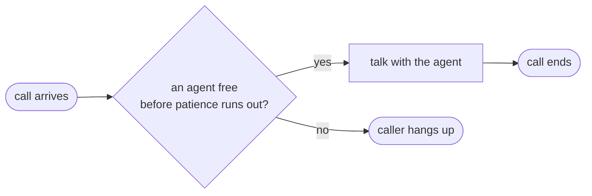
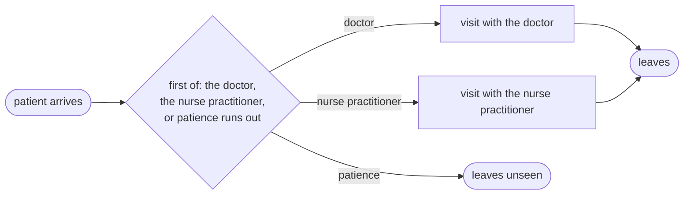
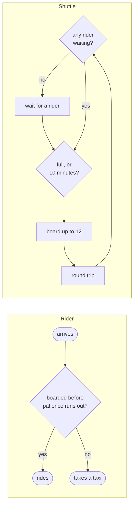
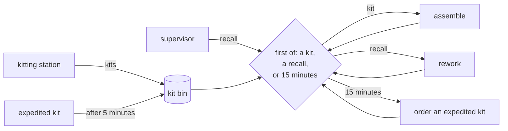

# Waiting with a deadline, or for whichever comes first — a tutorial through the examples

*Five worked cases.* Each one states a **problem**, describes the **system** with a table of every
distribution and parameter, draws the **model**, gives **the whole of its code** with an explanation of
every part, shows what it **produced**, and says **how we know it is right**: each example is checked
against an answer found some other way, either the exact result of a queueing model or the same system
written another way. Every number on this page came from running the example named beside it.

**New in R1.9.**

> **Status: experimental.** Waits with a time limit (`seizeOrTimeout`, `waitForOrTimeout`,
> `waitForItemsOrTimeout`, `suspendForOrTimeout`, `receiveMessageOrTimeout`) and waits for the first of
> several things (`waitForFirst` and its triggers) are released as experimental until the textbook covers
> them. Their API may change in a future release.

This page assumes you can read a process model: an entity, its `process { … }`, `seize`, `delay` and
`release`, as in the textbook's chapter 6. The reference for every function used here is
[`ksl-entity`](ksl-entity.md), sections "...renege", "...wait with a deadline" and "...wait for whichever
comes first".

---

## How to read this tutorial

A process waits in many places: for a resource, for a signal, for items in a blocking queue, for a
message, for another process to resume it. Until R1.9 each of those waits was open-ended. A process could
not say *wait for at most 15 minutes*, nor *wait for this or that, whichever happens first*, without
scheduling events of its own to find and remove itself. The cases below show both kinds of wait, one
construct at a time, and then together.

| # | Case | What it teaches | Run it with |
|---|---|---|---|
| 1 | [Impatient callers](#1-impatient-callers) | a seize with a time limit; counting those who give up; Little's law | `:KSLExamples:impatientCallers` |
| 2 | [The walk-in clinic, two ways](#2-the-walk-in-clinic-two-ways) | the textbook's reneging, written as one call | `:KSLExamples:walkInClinicTwoWays` |
| 3 | [First free of two](#3-first-free-of-two) | waiting for whichever of two resources is free first | `:KSLExamples:firstFreeOfTwo` |
| 4 | [The shuttle that leaves full or on time](#4-the-shuttle-that-leaves-full-or-on-time) | two parties, each waiting for the other with a deadline | `:KSLExamples:shuttleStop` |
| 5 | [Kitting, with expediting](#5-kitting-with-expediting) | three things in one wait; ties at one instant | `:KSLExamples:kittingWithExpediting` |

The examples are in `KSLExamples/src/main/kotlin/ksl/examples/general/processview/waits/`. Each has a
`main`; from IntelliJ, run it with the green arrow beside it, or from the command line with the Gradle task
in the table.

**Reading the code.** Each case gives its example **in full**, apart from the license header, the import
list and the file's own documentation comments, which this page replaces. The code is split into numbered
parts, each followed by what it does and why. Case 2 is the exception: most of its model is the textbook's
clinic, line for line, so only the lines that differ are shown.

**Reading the numbers.** Every model here runs several replications from fixed random number streams, so
running an example gives exactly the numbers on this page. Where an estimate is compared with an exact
value, the comparison is a 99% confidence interval from the replications, and the question is whether the
exact value lies inside it. Where two formulations of one system are compared, they draw the same random
numbers in the same order, and the question is whether every result is *identical*: not close, the same.

`WaitsExamplesValidationTest` in `KSLExamples/src/test` repeats every one of these checks on each build.

---

## 1. Impatient callers

### The problem

A call centre answers calls with a fixed team of agents. When every agent is busy, a caller waits on hold,
but not for ever: each caller has a limit, and a caller who reaches it hangs up. The centre wants to know
what fraction of its callers it loses this way, and how long callers wait.

### The system

Calls arrive at random, one every 25 seconds on average. Ten agents answer them in the order they
arrived. A call lasts four minutes on average. Each caller's patience, the longest they will wait on
hold, is random, three minutes on average.

| Quantity | Distribution or value | Model element |
|---|---|---|
| Time between calls | exponential, mean 1/2.4 minutes (2.4 calls a minute) | `timeBetweenCalls` |
| Number of agents | 10 | `Agents` |
| Call length | exponential, mean 4 minutes | `ServiceTime` |
| Patience | exponential, mean 3 minutes | `Patience` |
| Replications | 20 of 20,000 minutes, after a warm-up of 2,000 | |

With every time exponential, this is the M/M/c+M queue, also called Erlang-A, and its long-run answers are
known exactly. That is what makes it a good first case: the simulation can be checked against them.

### The model



*Figure 1 — a caller's process. The decision is one call, `seizeOrTimeout`: it waits for an agent, but for
no longer than the caller's patience.*

### The code

`ImpatientCallers.kt` in full.

#### 1. The model's parameters and its elements

```kotlin
class CallCenter(
    parent: ModelElement,
    numAgents: Int = 10,
    val arrivalRate: Double = 2.4,
    meanServiceTime: Double = 4.0,
    meanPatience: Double = 3.0,
    recordRenegedWait: Boolean = true,
    name: String? = null
) : ProcessModel(parent, name) {

    private val agents = ResourceWithQ(this, "Agents", capacity = numAgents)
    private val timeBetweenCalls = ExponentialRV(1.0 / arrivalRate, 1)
    private val serviceTime = RandomVariable(this, ExponentialRV(meanServiceTime, 2), "ServiceTime")
    private val patience = RandomVariable(this, ExponentialRV(meanPatience, 3), "Patience")
    private val recordAbandonedWaits = recordRenegedWait

    private val abandoned = Response(this, "ProbAbandon")
    private val numAbandoned = Counter(this, "NumAbandoned")
    private val numServed = Counter(this, "NumServed")

    /** The proportion of callers who hang up. */
    val probAbandon get() = abandoned
    /** The time-average number of callers waiting. */
    val numWaiting get() = agents.waitingQ.numInQ
    /** The time callers wait, for every caller or only those answered: see [recordRenegedWait]. */
    val timeWaiting get() = agents.waitingQ.timeInQ
```

The constructor takes every parameter of the table above as a default, so `CallCenter(model)` builds the
system as described, and a study can change any of them. `recordRenegedWait` is the subject of part 4.

`Agents` is a `ResourceWithQ`: a resource with its own queue, where callers wait. The three statistics
are a `Response` whose observations are 1 for a caller who hangs up and 0 for one who is answered, so its
average is the proportion who hang up, and two counters. The properties at the end expose what the
example's `main` and its test need to read.

#### 2. The caller

```kotlin
    private inner class Caller : Entity() {
        val call: KSLProcess = process(isDefaultProcess = true) {
            val result = seizeOrTimeout(
                agents,
                timeout = patience.value,
                recordRenegedWait = recordAbandonedWaits
            )
            if (result.timedOut) {
                abandoned.value = 1.0
                numAbandoned.increment()
                return@process
            }
            abandoned.value = 0.0
            delay(serviceTime)
            release(result.value)
            numServed.increment()
        }
    }

    private val generator = EntityGenerator(::Caller, timeBetweenCalls, timeBetweenCalls)
}
```

This is the whole of the new construct. `seizeOrTimeout` seizes as `seize` does: the caller's request
joins the agents' queue and is served in the same order. The difference is `timeout`: if no agent has been
given to the caller by then, the request leaves the queue, nothing is allocated, and the call returns
**timed out**. The timeout here is a fresh draw of `patience` for each caller.

The result is a `WaitResult`. `result.timedOut` says which way the wait ended. If it did not time out,
`result.value` is the allocation, released as any other. There is no built-in count of callers who give
up: the model counts them from `timedOut`, as here.

What is *not* here matters as much. In the textbook's style of reneging (case 2), the caller would schedule
an event for the end of its patience, and the event would find the caller's request in the queue and
remove it. Here there is no event to write and no request to find.

#### 3. The exact answers

```kotlin
class ErlangA(val lambda: Double, val mu: Double, val theta: Double, val c: Int) {

    /** The mean number of customers waiting. */
    val meanNumberWaiting: Double

    init {
        require(lambda > 0.0 && mu > 0.0 && theta > 0.0 && c >= 1) { "rates must be > 0 and c >= 1" }
        // p(n) is proportional to the product of birth over death rates up to n; stop when it is negligible
        var term = 1.0
        var total = 1.0
        var waiting = 0.0
        var n = 0
        while (true) {
            n++
            term *= lambda / (minOf(n, c) * mu + maxOf(n - c, 0) * theta)
            total += term
            waiting += maxOf(n - c, 0) * term
            if (n > c && term < 1.0e-16 * total) break
        }
        meanNumberWaiting = waiting / total
    }

    /** The probability that a customer abandons. */
    val probAbandon: Double get() = theta * meanNumberWaiting / lambda

    /** The mean time in queue of all customers, those who abandon included. */
    val meanWait: Double get() = meanNumberWaiting / lambda
}
```

Count the callers in the system, waiting or talking. A new caller adds one, at rate λ = 2.4 a minute. With
`n` callers in the system, `min(n, c)` are talking, each finishing at rate μ = 1/4, and `max(n − c, 0)` are
waiting, each hanging up at rate θ = 1/3. So the count is a birth-death process, and its long-run
distribution is the product of birth over death rates, normalized. `ErlangA` sums that product until the
terms are negligible, and from it gets the mean number waiting, `Lq`.

Two more answers follow from `Lq`. Waiting callers hang up at total rate `θ Lq`, so the fraction of callers
who hang up is `θ Lq / λ`. And by Little's law, the mean time on hold of *all* callers, those who hang up
included, is `Lq / λ`.

#### 4. The study

```kotlin
fun main() {
    val exact = ErlangA(lambda = 2.4, mu = 1.0 / 4.0, theta = 1.0 / 3.0, c = 10)

    val model = Model("ImpatientCallers", autoCSVReports = false)
    val center = CallCenter(model, name = "CallCenter")
    model.numberOfReplications = 20
    model.lengthOfReplication = 20_000.0
    model.lengthOfReplicationWarmUp = 2_000.0
    model.simulate()

    println("The call centre against the M/M/c+M (Erlang-A) answers, 99% confidence intervals")
    println(String.format("%-28s %10s %22s %10s %8s", "quantity", "estimate", "interval", "exact", "inside"))
    compare("probability of abandoning", center.probAbandon.acrossReplicationStatistic, exact.probAbandon)
    compare("mean number waiting", center.numWaiting.acrossReplicationStatistic, exact.meanNumberWaiting)
    compare("mean wait, all callers", center.timeWaiting.acrossReplicationStatistic, exact.meanWait)

    val notRecorded = Model("ImpatientCallersWaitsOfServedOnly", autoCSVReports = false)
    val centerServedOnly = CallCenter(notRecorded, recordRenegedWait = false, name = "CallCenter")
    notRecorded.numberOfReplications = 20
    notRecorded.lengthOfReplication = 20_000.0
    notRecorded.lengthOfReplicationWarmUp = 2_000.0
    notRecorded.simulate()

    println()
    println("Little's law, L = lambda W, with lambda = ${center.arrivalRate} calls per minute")
    println(String.format("%-36s %10s %12s", "abandoned waits", "L", "lambda W"))
    littlesLaw("recorded (the default)", center)
    littlesLaw("not recorded", centerServedOnly)
    println()
    println("Read this alongside docs/guides/ksl-waits-tutorial.md, case 1.")
}
```

The first run sets each estimate beside its exact value. The second run is the same centre with
`recordRenegedWait = false`, which leaves the waits of callers who hung up out of the queue's time in
queue. The centre is otherwise identical, so its number waiting is identical too. Little's law, L = λW,
is then checked for both.

#### 5. Printing

```kotlin
private fun compare(label: String, stat: ksl.utilities.statistic.StatisticIfc, exact: Double) {
    val ci = stat.confidenceInterval(0.99)
    println(
        String.format(
            "%-28s %10.4f %22s %10.4f %8s", label, stat.average,
            String.format("[%.4f, %.4f]", ci.lowerLimit, ci.upperLimit), exact, if (exact in ci) "yes" else "NO"
        )
    )
}

private fun littlesLaw(label: String, center: CallCenter) {
    val l = center.numWaiting.acrossReplicationStatistic.average
    val lambdaW = center.arrivalRate * center.timeWaiting.acrossReplicationStatistic.average
    println(String.format("%-36s %10.4f %12.4f", label, l, lambdaW))
}
```

### What it shows

```text
The call centre against the M/M/c+M (Erlang-A) answers, 99% confidence intervals
quantity                       estimate               interval      exact   inside
probability of abandoning        0.1174       [0.1153, 0.1196]     0.1174      yes
mean number waiting              0.8497       [0.8326, 0.8669]     0.8450      yes
mean wait, all callers           0.3540       [0.3475, 0.3605]     0.3521      yes

Little's law, L = lambda W, with lambda = 2.4 calls per minute
abandoned waits                               L     lambda W
recorded (the default)                   0.8497       0.8495
not recorded                             0.8497       0.7509
```

### How we know it is right

All three exact values lie inside their 99% intervals, and the proportion who hang up agrees to the
fourth decimal. The simulation has no knowledge of the birth-death argument: it only queues callers,
times them out and counts. So agreement with `ErlangA` is evidence that `seizeOrTimeout` withdraws a
request at the right moment, that the queue serves the others in the right order, and that a caller who
gives up is never also served.

### What to learn

**About 12% of callers hang up**, although the agents are busy only 85% of the time on average: the
callers answered, 2.4 × (1 − 0.1174) a minute, each take 4 minutes of one of 10 agents. Impatience
shortens the queue it is caused by.

**Decide what the time in queue means.** By default a wait that ends in a timeout is recorded in the
queue's time in queue, so the queue's statistics obey Little's law: 0.8497 against 0.8495. With
`recordRenegedWait = false`, the time in queue is the wait of the callers who were answered, which is
shorter, and L = λW no longer holds (0.8497 against 0.7509), because L still counts every caller who
waited. Neither is wrong; they answer different questions. Choose one, and say which you reported.

**Count those who give up yourself,** from `timedOut`. The model decides what giving up means: here a
caller who hangs up, in case 2 a patient who leaves, in case 5 an assembler who expedites.

---

## 2. The walk-in clinic, two ways

### The problem

The textbook's walk-in health clinic (section 7.5.1, `WalkInHealthClinic`, run by `Ch7Example8`) lets
low-priority patients give up on waiting for a doctor. It does that the only way the KSL allowed before
R1.9: each such patient schedules an event for the end of their patience, and the event finds their request
in the doctors' queue and removes it with `removeAndTerminate`. This case writes the same clinic with
`seizeOrTimeout`, and checks that nothing else changes.

### The system

Exactly the textbook's clinic: patients arrive about every six minutes; a triage nurse sees each; five
doctors see them in order of priority (high, medium, low, with different treatment times); low-priority
patients balk if the doctors' queue is too long, and give up after waiting a uniform 10 to 20 minutes.
The textbook's section 7.5.1 has its table of distributions; none is changed here.

| Quantity | Distribution or value |
|---|---|
| Patience of a low-priority patient | uniform, 10 to 20 minutes, stream 6 |
| Replications | 30 of 600 minutes, as `Ch7Example8` |

### The model

The textbook draws this clinic in section 7.5.1. One step differs: where the textbook's patient schedules
its renege and then seizes a doctor, this patient seizes a doctor with a time limit.

### The code

`WalkInHealthClinicViaTimedSeize.kt` is the textbook's `WalkInHealthClinic.kt` with one part of the
patient's process replaced. The textbook's version, from `WalkInHealthClinic.kt`:

```kotlin
use(triageNurseR, delayDuration = triageRV)
// only low priority renege
if (priority == 3) {
    schedule(this@Patient::renegeAction, renegeTimeRV, message = this@Patient)
}
val a = seize(doctorR)
delay(service)
release(a)
```

```kotlin
private fun renegeAction(event: KSLEvent<Patient>) {
    val request: ProcessModel.Entity.Request? = doctorQ.find { it.entity == event.message }
    if (request != null) {
        doctorQ.removeAndTerminate(request)
        // reneging statistics
        renegingProb.value = 1.0
        numReneged.increment()
    }
}
```

#### 1. The replacement

```kotlin
use(triageNurseR, delayDuration = triageRV)
// only low priority renege: a seize with a time limit, the patience sampled where the event was
val a = if (priority == 3) {
    val patience = renegeTimeRV.value
    val result = seizeOrTimeout(doctorR, timeout = patience, recordRenegedWait = false)
    if (result is WaitResult.TimedOut) {
        // reneging statistics
        renegingProb.value = 1.0
        numReneged.increment()
        return@process
    }
    result.value
} else {
    seize(doctorR)
}
delay(service)
release(a)
```

The textbook's two pieces, an event scheduled before the seize and an event action that searches the
queue, become one `if`. The patience is drawn at the same point in the process, from the same stream, so
each patient's patience is the same in both models.

`recordRenegedWait = false` is there for a reason. `removeAndTerminate` does not record the wait of the
request it removes, so to give the same queue statistics as the textbook's clinic, the timed seize must
not record it either. (Case 1 explains what that choice does to Little's law.)

The rest of the file, the clinic's resources, random variables, statistics and the rest of the patient's
process, is the textbook's, unchanged.

#### 2. The comparison

```kotlin
fun main() {
    fun run(build: (Model) -> Unit): Model {
        val m = Model("WalkInClinic", autoCSVReports = false)
        build(m)
        m.lengthOfReplication = 10.0 * 60.0
        m.numberOfReplications = 30
        m.simulate()
        return m
    }
    val byEvent = run { WalkInHealthClinic(it, "Walk-In Clinic") }
    val byTimedSeize = run { WalkInHealthClinicViaTimedSeize(it, "Walk-In Clinic") }

    fun statistics(m: Model) = m.responses.associate { it.name to it.acrossReplicationStatistic } +
            m.counters.associate { it.name to it.acrossReplicationStatistic }
    val event = statistics(byEvent)
    val timed = statistics(byTimedSeize)
    println(String.format("%-40s %14s %14s %8s", "response", "by an event", "by seizeOrTimeout", "same"))
    var allSame = event.keys == timed.keys
    for (name in event.keys.sorted()) {
        val a = event.getValue(name)
        val b = timed[name]
        val same = b != null && a.average == b.average && a.variance == b.variance && a.count == b.count
        allSame = allSame && same
        println(String.format("%-40s %14.4f %14.4f %8s", name, a.average, b?.average ?: Double.NaN, if (same) "yes" else "NO"))
    }
    println()
    println(if (allSame) "Every response and counter is identical." else "The two models DIFFER.")
    println()
    println("Read this alongside docs/guides/ksl-waits-tutorial.md, case 2.")
}
```

Both clinics are built under the same name, so their statistics have the same names, and every response
and counter is compared: its count, its average and its variance across the 30 replications.

### What it shows

```text
response                                    by an event by seizeOrTimeout     same
DoctorQ:NumInQ                                   0.9304         0.9304      yes
DoctorQ:TimeInQ                                  4.7896         4.7896      yes
Doctors:InstantaneousUtil                        0.7794         0.7794      yes
Doctors:NumActiveUnits                           5.0000         5.0000      yes
Doctors:NumBusyUnits                             3.8971         3.8971      yes
Doctors:PTimeBusy                                0.9751         0.9751      yes
Doctors:PTimeIdle                                0.0249         0.0249      yes
Doctors:PTimeInactive                            0.0000         0.0000      yes
Doctors:ScheduledUtil                            0.7794         0.7794      yes
Doctors:SeizeCount                              94.7333        94.7333      yes
Doctors:WIP                                      4.8276         4.8276      yes
TriageNurse:InstantaneousUtil                    0.4209         0.4209      yes
TriageNurse:NumActiveUnits                       1.0000         1.0000      yes
TriageNurse:NumBusyUnits                         0.4209         0.4209      yes
TriageNurse:PTimeBusy                            0.4209         0.4209      yes
TriageNurse:PTimeIdle                            0.5791         0.5791      yes
TriageNurse:PTimeInactive                        0.0000         0.0000      yes
TriageNurse:Q:NumInQ                             0.1544         0.1544      yes
TriageNurse:Q:TimeInQ                            0.8892         0.8892      yes
TriageNurse:ScheduledUtil                        0.4209         0.4209      yes
TriageNurse:SeizeCount                         101.2333       101.2333      yes
TriageNurse:WIP                                  0.5753         0.5753      yes
Walk-In Clinic:NumBalked                         0.0000         0.0000      yes
Walk-In Clinic:NumReneged                        4.3667         4.3667      yes
Walk-In Clinic:NumServed                        90.6333        90.6333      yes
Walk-In Clinic:ProbBalking                       0.0000         0.0000      yes
Walk-In Clinic:ProbReneging                      0.2934         0.2934      yes
Walk-In Clinic:TimeInSystem                     33.1647        33.1647      yes
Walk-In Clinic:TimeInSystemHigh                 43.7704        43.7704      yes
Walk-In Clinic:TimeInSystemLow                  17.1881        17.1881      yes
Walk-In Clinic:TimeInSystemMedium               31.4701        31.4701      yes

Every response and counter is identical.
```

### How we know it is right

All 31 statistics are identical, to every digit, including their variances. The clinic reneges (4.37
patients a replication), so the comparison exercises the timed seize rather than passing because nobody
gave up. Identical results mean each patient gave up at the same moment, from the same place in the queue,
leaving the same patients behind them, in both models.

### What to learn

**A time limit on a seize is a property of the wait,** not an event the model manages. Nothing has to be
searched for, and there is no window between scheduling the renege and starting the seize in which the
two can disagree.

**When rewriting a model, make the rewrite provable.** Drawing the patience at the same point, from the
same stream, and matching the statistics option is what turns "it looks the same" into "it is the same".

---

## 3. First free of two

### The problem

A small clinic has a doctor and a nurse practitioner, and either can see a walk-in patient. A patient
wants whichever is free first, and leaves if neither becomes free in time. With one queue per provider,
the patient must wait in both at once, and leave the other the moment one of them is free.

### The system

| Quantity | Distribution or value | Model element |
|---|---|---|
| Time between patients | exponential, mean 12 minutes | `timeBetweenArrivals` |
| Providers | a doctor and a nurse practitioner, one of each | `Doctor`, `NursePractitioner` |
| Visit length, either provider | exponential, mean 20 minutes | `ServiceTime` |
| Patience | exponential, mean 30 minutes | `Patience` |
| Replications | 20 of 100,000 minutes, after a warm-up of 10,000 | |

Each provider's queue is first come, first served. A waiting patient is in both, so each provider, when
free, takes the patient who has waited longest. The two queues therefore act as one queue served by two
providers, and with equal visit lengths the clinic is the M/M/2+M queue: case 1's model with c = 2.

### The model



*Figure 2 — one wait with three ways out.*

### The code

`FirstFreeOfTwo.kt` in full.

#### 1. The clinic

```kotlin
class TwoProviderClinic(
    parent: ModelElement,
    val arrivalRate: Double = 1.0 / 12.0,
    meanServiceTime: Double = 20.0,
    meanPatience: Double = 30.0,
    name: String? = null
) : ProcessModel(parent, name) {

    private val doctor = ResourceWithQ(this, "Doctor")
    private val nursePractitioner = ResourceWithQ(this, "NursePractitioner")
    private val timeBetweenArrivals = ExponentialRV(1.0 / arrivalRate, 1)
    private val serviceTime = RandomVariable(this, ExponentialRV(meanServiceTime, 2), "ServiceTime")
    private val patience = RandomVariable(this, ExponentialRV(meanPatience, 3), "Patience")

    private val leftUnseen = Response(this, "ProbLeftUnseen")
    private val seenByDoctor = Response(this, "ProbSeenByDoctor")
    private val numLeftUnseen = Counter(this, "NumLeftUnseen")

    /** The proportion of patients who leave without being seen. */
    val probLeftUnseen get() = leftUnseen
    /** Of the patients seen, the proportion seen by the doctor. */
    val probSeenByDoctor get() = seenByDoctor
    /** The time-average number of patients waiting. Every waiting patient is in the doctor's queue. */
    val numWaiting get() = doctor.waitingQ.numInQ
```

Two separate resources, each with its own queue. `numWaiting` reads the doctor's queue only: every
waiting patient is in it, so its length is the number waiting.

#### 2. The patient

```kotlin
    private inner class Patient : Entity() {
        val visit: KSLProcess = process(isDefaultProcess = true) {
            val byDoctor = doctor.seizeTrigger()
            val byNursePractitioner = nursePractitioner.seizeTrigger()
            val result = waitForFirst(byDoctor, byNursePractitioner, timeout = patience.value)
            if (result.timedOut) {
                leftUnseen.value = 1.0
                numLeftUnseen.increment()
                return@process
            }
            leftUnseen.value = 0.0
            val provider = if (result.firedBy(byDoctor)) byDoctor else byNursePractitioner
            seenByDoctor.value = if (provider === byDoctor) 1.0 else 0.0
            val allocation = result.valueOf(provider)
            delay(serviceTime)
            release(allocation)
        }
    }

    private val generator = EntityGenerator(::Patient, timeBetweenArrivals, timeBetweenArrivals)
}
```

`seizeTrigger()` makes a **trigger**: a description of a seize that `waitForFirst` can wait on alongside
other things. It does not seize anything by itself. `waitForFirst(byDoctor, byNursePractitioner, timeout
= …)` places the patient's request in both queues and waits until the first of three things happens. When
one provider is given to the patient, the request in the other queue is withdrawn at once, before anyone
else can be served by it, and nothing is allocated there.

The result says which trigger ended the wait: `firedBy(byDoctor)` asks, and `valueOf(provider)` gives the
allocation of the provider who did. `valueOf` of a trigger that did not end the wait throws; that is why
the code asks first.

#### 3. The study

```kotlin
fun main() {
    val exact = ErlangA(lambda = 1.0 / 12.0, mu = 1.0 / 20.0, theta = 1.0 / 30.0, c = 2)

    val model = Model("FirstFreeOfTwo", autoCSVReports = false)
    val clinic = TwoProviderClinic(model, name = "Clinic")
    model.numberOfReplications = 20
    model.lengthOfReplication = 100_000.0
    model.lengthOfReplicationWarmUp = 10_000.0
    model.simulate()

    println("The two-provider clinic against the M/M/2+M answers, 99% confidence intervals")
    println(String.format("%-28s %10s %22s %10s %8s", "quantity", "estimate", "interval", "exact", "inside"))
    val left = clinic.probLeftUnseen.acrossReplicationStatistic
    val waiting = clinic.numWaiting.acrossReplicationStatistic
    for ((label, stat, value) in listOf(
        Triple("probability of leaving", left, exact.probAbandon),
        Triple("mean number waiting", waiting, exact.meanNumberWaiting)
    )) {
        val ci = stat.confidenceInterval(0.99)
        println(
            String.format(
                "%-28s %10.4f %22s %10.4f %8s", label, stat.average,
                String.format("[%.4f, %.4f]", ci.lowerLimit, ci.upperLimit), value, if (value in ci) "yes" else "NO"
            )
        )
    }
    println()
    println(String.format("Of the patients seen, %.4f were seen by the doctor.", clinic.probSeenByDoctor.acrossReplicationStatistic.average))
    println()
    println("Read this alongside docs/guides/ksl-waits-tutorial.md, case 3.")
}
```

The exact values come from case 1's `ErlangA`, with two servers.

### What it shows

```text
The two-provider clinic against the M/M/2+M answers, 99% confidence intervals
quantity                       estimate               interval      exact   inside
probability of leaving           0.1909       [0.1864, 0.1954]     0.1907      yes
mean number waiting              0.4756       [0.4628, 0.4884]     0.4768      yes

Of the patients seen, 0.5406 were seen by the doctor.
```

### How we know it is right

Both exact values lie inside their intervals. The M/M/2+M answer assumes one queue and two servers; the
model has two queues and a patient in both. Agreement means the withdrawal from the other queue is
complete and immediate: a patient is never seen twice, never left behind in the other queue to block it,
and never served out of turn.

### What to learn

**The order of the triggers settles a tie.** 54% of the patients seen saw the doctor, not 50%. When a
patient arrives to find *both* providers free, both triggers could fire at once, and the first one in the
argument list wins: the doctor. When only one is free, or when they become free at different moments, the
order plays no part. If a tie should be settled some other way, by a preference or at random, order the
triggers accordingly for each patient.

**One wait, any mix of things.** The same `waitForFirst` accepts seize triggers for resources and pools,
signal triggers, items triggers on blocking queues and message triggers on mailboxes, in any combination.
Case 5 uses three different kinds.

---

## 4. The shuttle that leaves full or on time

### The problem

A shuttle runs from a stop to a terminal and back. A shuttle that waits until it is full gives the riders
at the stop a long wait when riders are few; one that leaves as soon as a rider boards wastes seats. This
shuttle leaves when it is full, or a fixed time after it began waiting with a rider aboard, whichever comes
first. Meanwhile riders do not wait for ever: one who has waited too long takes a taxi. Both parties wait
with a deadline, and each one's wait can be ended by the other.

### The system

| Quantity | Distribution or value | Model element |
|---|---|---|
| Time between riders | exponential, mean 2 minutes (0.5 a minute) | `timeBetweenArrivals` |
| Seats on the shuttle | 12 | `capacity` |
| Longest hold with a rider aboard | 10 minutes | `maxHold` |
| Round trip | triangular, 10, 15, 20 minutes | `RoundTrip` |
| Rider's patience | exponential, mean 30 minutes | `Patience` |
| Replications | 20 of 10,000 minutes, after a warm-up of 1,000 | |

This system has no simple exact answer. It is checked instead against the same system written with
events.

### The model



*Figure 3 — two processes, each waiting with a deadline, each able to end the other's wait.*

### The code

`ShuttleStop.kt` in full.

#### 1. The stop

```kotlin
class ShuttleStop(
    parent: ModelElement,
    val capacity: Int = 12,
    val maxHold: Double = 10.0,
    arrivalRate: Double = 0.5,
    meanPatience: Double = 30.0,
    name: String? = null
) : ProcessModel(parent, name) {

    private val timeBetweenArrivals = ExponentialRV(1.0 / arrivalRate, 1)
    private val patience = RandomVariable(this, ExponentialRV(meanPatience, 2), "Patience")
    private val roundTrip = RandomVariable(this, TriangularRV(10.0, 15.0, 20.0, 3), "RoundTrip")

    private val waiting = mutableListOf<Rider>()
    private val riderArrived = Signal(this, "RiderArrived")
    private val shuttleFull = Signal(this, "ShuttleFull")

    private val numWaiting = TWResponse(this, "NumWaiting")
    private val waitForShuttle = Response(this, "WaitForShuttle")
    private val tookTaxi = Response(this, "ProbTaxi")
    private val tripLoad = Response(this, "TripLoad")
    private val numFullDepartures = Counter(this, "NumFullDepartures")
    private val numTimedDepartures = Counter(this, "NumTimedDepartures")
```

The riders waiting at the stop are a plain list, in arrival order. Two signals connect the riders to the
shuttle: `RiderArrived` and `ShuttleFull`. The statistics are the number waiting over time, each boarded
rider's wait, the proportion who take a taxi, and each trip's load.

#### 2. The rider

```kotlin
private inner class Rider : Entity() {
    val boarded = Suspension("boarded")

    val trip: KSLProcess = process(isDefaultProcess = true) {
        val myPatience = patience.value
        waiting.add(this@Rider)
        numWaiting.increment()
        riderArrived.signal()
        if (waiting.size >= capacity) shuttleFull.signal()
        val result = suspendForOrTimeout(boarded, timeout = myPatience)
        if (result.timedOut) {
            waiting.remove(this@Rider)
            numWaiting.decrement()
            tookTaxi.value = 1.0
        }
    }
}
```

Each rider owns a **suspension**, `boarded`: a named point at which its process can be suspended and later
resumed by another process. The rider joins the list, tells the shuttle it has arrived, and, if it has
filled the shuttle, says so. Then it waits with `suspendForOrTimeout(boarded, timeout = myPatience)`: it is
suspended until the shuttle resumes it, or until its patience runs out, whichever comes first. If the time
runs out it leaves the list and takes a taxi. If it is resumed there is nothing more to do: the shuttle
has already recorded its wait.

A signal reaches only the processes waiting on it when it is sent. `riderArrived.signal()` while the
shuttle is away reaches no one, and that is correct: the shuttle looks at the list when it returns.

#### 3. The shuttle

```kotlin
    private inner class Shuttle : Entity() {
        val service: KSLProcess = process {
            while (true) {
                if (waiting.isEmpty()) waitFor(riderArrived)
                if (waiting.size < capacity) waitForOrTimeout(shuttleFull, timeout = maxHold)
                val boarding = waiting.take(capacity)
                if (boarding.isEmpty()) continue        // every rider gave up while the shuttle waited
                for (rider in boarding) {
                    waiting.remove(rider)
                    numWaiting.decrement()
                    waitForShuttle.value = time - rider.createTime
                    tookTaxi.value = 0.0
                    resume(rider.boarded)
                }
                tripLoad.value = boarding.size.toDouble()
                if (boarding.size == capacity) numFullDepartures.increment() else numTimedDepartures.increment()
                delay(roundTrip)
            }
        }
    }

    private val generator = EntityGenerator(::Rider, timeBetweenArrivals, timeBetweenArrivals)

    override fun initialize() {
        waiting.clear()
        activate(Shuttle().service)
    }
}
```

The shuttle is a process that loops. With nobody waiting, it waits for a rider, with no time limit. Then,
unless the shuttle is already full, it waits for `ShuttleFull` with a limit of `maxHold`: the second
deadline of the case. Whichever way that wait ends, it boards up to twelve riders in arrival order, and
for each it records the wait and calls `resume(rider.boarded)`, which ends that rider's
`suspendForOrTimeout`. If every rider gave up during the hold, there is nobody to board, and the shuttle
starts again.

`resume` is the way one process ends another's suspension. Calling `resumeProcess()` on the rider instead
would throw: an entity in a wait with a time limit can be resumed only through what it waits on.

#### 4. The same stop, written with events

```kotlin
class ShuttleStopByEvents(
    parent: ModelElement,
    val capacity: Int = 12,
    val maxHold: Double = 10.0,
    arrivalRate: Double = 0.5,
    meanPatience: Double = 30.0,
    name: String? = null
) : ModelElement(parent, name) {

    private val timeBetweenArrivals = RandomVariable(this, ExponentialRV(1.0 / arrivalRate, 1), "TimeBetweenArrivals")
    private val patience = RandomVariable(this, ExponentialRV(meanPatience, 2), "Patience")
    private val roundTrip = RandomVariable(this, TriangularRV(10.0, 15.0, 20.0, 3), "RoundTrip")

    private inner class Rider(val arrivalTime: Double) {
        var gaveUp: KSLEvent<Rider>? = null
    }

    private val waiting = ArrayDeque<Rider>()
    private var shuttleAtStop = true
    private var holdEnds: KSLEvent<Nothing>? = null

    private val numWaiting = TWResponse(this, "NumWaiting")
    private val waitForShuttle = Response(this, "WaitForShuttle")
    private val tookTaxi = Response(this, "ProbTaxi")
    private val tripLoad = Response(this, "TripLoad")
    private val numFullDepartures = Counter(this, "NumFullDepartures")
    private val numTimedDepartures = Counter(this, "NumTimedDepartures")

    override fun initialize() {
        waiting.clear()
        shuttleAtStop = true
        holdEnds = null
        schedule(::arrival, timeBetweenArrivals)
    }

    private fun arrival(event: KSLEvent<Nothing>) {
        val rider = Rider(time)
        rider.gaveUp = schedule(::riderGivesUp, patience, message = rider)
        waiting.addLast(rider)
        numWaiting.increment()
        if (shuttleAtStop) {
            if (waiting.size >= capacity) depart()
            else if (holdEnds == null) holdEnds = schedule(::holdTimeUp, maxHold)
        }
        schedule(::arrival, timeBetweenArrivals)
    }

    private fun riderGivesUp(event: KSLEvent<Rider>) {
        waiting.remove(event.message!!)
        numWaiting.decrement()
        tookTaxi.value = 1.0
    }

    private fun holdTimeUp(event: KSLEvent<Nothing>) {
        holdEnds = null
        if (waiting.isNotEmpty()) depart()
    }

    private fun depart() {
        holdEnds?.let { if (it.isScheduled) it.cancel = true }
        holdEnds = null
        val boarding = waiting.take(capacity)
        for (rider in boarding) {
            waiting.removeFirst()
            // an event due after the end of the replication was never put on the calendar
            rider.gaveUp?.let { if (it.isScheduled) it.cancel = true }
            numWaiting.decrement()
            waitForShuttle.value = time - rider.arrivalTime
            tookTaxi.value = 0.0
        }
        tripLoad.value = boarding.size.toDouble()
        if (boarding.size == capacity) numFullDepartures.increment() else numTimedDepartures.increment()
        shuttleAtStop = false
        schedule(::shuttleReturns, roundTrip)
    }

    private fun shuttleReturns(event: KSLEvent<Nothing>) {
        shuttleAtStop = true
        if (waiting.size >= capacity) depart()
        else if (waiting.isNotEmpty()) holdEnds = schedule(::holdTimeUp, maxHold)
    }
}
```

The same rules, written as event routines. A rider is a small record of its arrival time and the event at
which it will give up. An arrival schedules that event, joins the list and, if the shuttle is at the stop,
either sends it or starts its hold. A departure cancels the hold, boards riders by cancelling their give-up
events, and schedules the return.

The event version must undo by hand what the process version gets for free. When a rider boards, its
give-up event must be cancelled; in the process version, `resume` ends the rider's wait and its timer with
it. And an event due after the end of the replication is never put on the calendar, so cancelling it would
throw; hence the `isScheduled` checks.

Both versions draw the same random numbers in the same order: interarrival times from stream 1 as riders
arrive, patience from stream 2 as each rider arrives, round trips from stream 3 as the shuttle leaves.

#### 5. The comparison

```kotlin
fun main() {
    fun run(build: (Model) -> Unit): Model {
        val m = Model("ShuttleStop", autoCSVReports = false)
        build(m)
        m.numberOfReplications = 20
        m.lengthOfReplication = 10_000.0
        m.lengthOfReplicationWarmUp = 1_000.0
        m.simulate()
        return m
    }
    val byProcesses = run { ShuttleStop(it, name = "Stop") }
    val byEvents = run { ShuttleStopByEvents(it, name = "Stop") }

    fun statistics(m: Model) = m.responses.associate { it.name to it.acrossReplicationStatistic } +
            m.counters.associate { it.name to it.acrossReplicationStatistic }
    val p = statistics(byProcesses)
    val e = statistics(byEvents)
    val shared = listOf("NumWaiting", "WaitForShuttle", "ProbTaxi", "TripLoad", "NumFullDepartures", "NumTimedDepartures")
    println(String.format("%-22s %14s %14s %12s %8s", "response", "by processes", "by events", "half-width", "same"))
    var allSame = true
    for (name in shared) {
        val a = p.getValue(name)
        val b = e.getValue(name)
        val same = a.average == b.average && a.variance == b.variance && a.count == b.count
        allSame = allSame && same
        println(String.format("%-22s %14.4f %14.4f %12.4f %8s", name, a.average, b.average, a.halfWidth, if (same) "yes" else "NO"))
    }
    println()
    println(if (allSame) "The two models agree exactly." else "The two models DIFFER.")
    println()
    println("Read this alongside docs/guides/ksl-waits-tutorial.md, case 4.")
}
```

### What it shows

```text
response                 by processes      by events   half-width     same
NumWaiting                     4.5340         4.5340       0.0292      yes
WaitForShuttle                 9.9548         9.9548       0.0666      yes
ProbTaxi                       0.3008         0.3008       0.0045      yes
TripLoad                       8.4065         8.4065       0.0792      yes
NumFullDepartures             78.1000        78.1000       4.8230      yes
NumTimedDepartures           296.0000       296.0000       3.9567      yes

The two models agree exactly.
```

### How we know it is right

The two formulations agree in every statistic, exactly. Both ways of leaving occur, 78 full departures and
296 timed ones a replication, and three in ten riders give up, so every deadline in the model is
exercised many thousands of times. Each formulation would have to make the same mistake at the same moment
for the agreement to hide one.

### What to learn

**The stop loses three riders in ten.** Most trips leave on time, not full, with eight riders on average:
the hold rarely fills the shuttle, and a rider who arrives as it leaves faces a round trip of 15 minutes on
average before it is back. Varying `maxHold` and `capacity` (they are constructor parameters, and
controls of an experiment) asks whether holding longer would keep more riders than it costs them in
waiting.

**Two deadlines, no bookkeeping.** In the process version each party simply waits, with a limit, for the
other. The event version needs the give-up events cancelled, the hold event remembered and cancelled, and
guards for events past the end of the run. That bookkeeping is where event models of impatience go wrong.

---

## 5. Kitting, with expediting

### The problem

An assembler builds products from kits. A kitting station puts kits into a bin, and the assembler takes
them one at a time. While waiting for a kit, three different things can end the wait, and the assembler
must respond to whichever comes first: a kit arrives; the supervisor calls the assembler away to a rework
job; or the wait has gone on so long that the assembler orders an expedited kit.

### The system

| Quantity | Distribution or value | Model element |
|---|---|---|
| Time between kits | exponential, mean 10 minutes | `TimeBetweenKits` |
| Assembly time | uniform, 6 to 9 minutes | `AssemblyTime` |
| Time between the supervisor's recalls | exponential, mean 60 minutes | `TimeBetweenRecalls` |
| Rework job | 10 minutes | `ReworkTime` |
| Wait before expediting | 15 minutes | `expediteAfter` |
| Expedited kit's lead time | 5 minutes; one at a time | `expediteLeadTime` |
| Replications | 20 of 10,000 minutes | |

The supervisor calls for rework whether or not the assembler is waiting. A call made while the assembler is
busy is not remembered: it reaches no one.

### The model



*Figure 4 — the assembler's wait, with three ways out.*

### The code

`KittingWithExpediting.kt` in full.

#### 1. The cell

```kotlin
class KittingCell(
    parent: ModelElement,
    timeBetweenKits: RVariableIfc = ExponentialRV(10.0, 1),
    assemblyTime: RVariableIfc = UniformRV(6.0, 9.0, 2),
    timeBetweenRecalls: RVariableIfc = ExponentialRV(60.0, 3),
    reworkTime: RVariableIfc = ConstantRV(10.0),
    val expediteAfter: Double = 15.0,
    val expediteLeadTime: Double = 5.0,
    private val trace: Boolean = false,
    name: String? = null
) : ProcessModel(parent, name) {

    private val kitInterval = RandomVariable(this, timeBetweenKits, "TimeBetweenKits")
    private val assembly = RandomVariable(this, assemblyTime, "AssemblyTime")
    private val recallInterval = RandomVariable(this, timeBetweenRecalls, "TimeBetweenRecalls")
    private val rework = RandomVariable(this, reworkTime, "ReworkTime")

    private inner class Kit(val expedited: Boolean) : QObject()

    private val kitBin: BlockingQueue<Kit> = BlockingQueue(this, name = "KitBin")
    private val recall = Signal(this, "Recall")

    private val kitsMade = Counter(this, "KitsMade")
    private val kitsExpedited = Counter(this, "KitsExpedited")
    private val kitsAssembled = Counter(this, "KitsAssembled")
    private val recallsSent = Counter(this, "RecallsSent")
    private val recallsAnswered = Counter(this, "RecallsAnswered")
    private val unaccounted = Response(this, "KitsUnaccounted")

    private var kitInAssembly = 0
    private var expediteOutstanding = false

    private fun log(what: String) {
        if (trace) println(String.format("%8.2f  %s", time, what))
    }
```

The random times are constructor parameters of type `RVariableIfc`, so `main` can run the cell with
constant times for a trace that can be followed by hand. The bin is a `BlockingQueue` of kits; the recall
is a `Signal`. `log` prints a line only when the cell is built with `trace = true`.

#### 2. The kitting station, the supervisor and the expedited kit

```kotlin
private inner class KittingStation : Entity() {
    val supply: KSLProcess = process {
        while (true) {
            delay(kitInterval)
            kitsMade.increment()
            log("a kit goes into the bin")
            send(Kit(expedited = false), kitBin)
        }
    }
}

private inner class Supervisor : Entity() {
    val oversight: KSLProcess = process {
        while (true) {
            delay(recallInterval)
            recallsSent.increment()
            log("the supervisor calls for rework")
            recall.signal()
        }
    }
}

private inner class Expediter : Entity() {
    val delivery: KSLProcess = process {
        delay(expediteLeadTime)
        kitsExpedited.increment()
        expediteOutstanding = false
        log("the expedited kit goes into the bin")
        send(Kit(expedited = true), kitBin)
    }
}
```

Three small processes. The station sends a kit into the bin at each interval. The supervisor signals a
recall at each interval, whether or not anyone is waiting for it. An `Expediter` is created for each
expedited kit: it waits out the lead time and sends the kit into the bin.

#### 3. The assembler

```kotlin
private inner class Assembler : Entity() {
    val work: KSLProcess = process {
        while (true) {
            val kitArrives = kitBin.itemsTrigger(amount = 1)
            val calledAway = recall.trigger()
            val result = waitForFirst(kitArrives, calledAway, timeout = expediteAfter)
            when (result.trigger) {
                kitArrives -> {
                    val kit = result.valueOf(kitArrives).first()
                    log("the assembler takes a${if (kit.expedited) "n expedited" else ""} kit, after waiting ${"%.2f".format(result.timeWaited)}")
                    kitInAssembly = 1
                    delay(assembly)
                    kitInAssembly = 0
                    kitsAssembled.increment()
                }
                calledAway -> {
                    recallsAnswered.increment()
                    log("the assembler answers the recall")
                    delay(rework)
                }
                null -> {
                    if (!expediteOutstanding) {
                        expediteOutstanding = true
                        log("the assembler has waited ${"%.2f".format(result.timeWaited)} and expedites a kit")
                        activate(Expediter().delivery)
                    }
                }
            }
        }
    }
}
```

The wait is one call with three ways out. `kitBin.itemsTrigger(amount = 1)` is a trigger for one item from
the bin; its value, when it fires, is the list of items taken. `recall.trigger()` is a trigger for the
signal. The timeout is the third way out. `result.trigger` is the trigger that ended the wait, or `null` if
the time ran out, so a `when` on it handles each case. An assembler who has already expedited a kit that
has not yet arrived does not expedite another; it simply waits again.

New triggers are made for each wait. A trigger holds no state of its own, so making them where the wait is
made costs nothing and keeps each wait's ways out together.

#### 4. Starting each replication, and the accounting

```kotlin
    override fun initialize() {
        kitInAssembly = 0
        expediteOutstanding = false
        activate(KittingStation().supply)
        activate(Supervisor().oversight)
        activate(Assembler().work)
    }

    /** Every kit made or expedited is assembled, being assembled, or in the bin. */
    override fun replicationEnded() {
        unaccounted.value = kitsMade.value + kitsExpedited.value - kitsAssembled.value - kitInAssembly - kitBin.channelQ.size
    }
}
```

At the end of each replication, every kit made or expedited must be assembled, being assembled, or still in
the bin. `KitsUnaccounted` records the difference, which must be zero.

#### 5. The study

```kotlin
fun main() {
    println("A short run with constant times: kits every 20 minutes, assembly 8, recalls every 30, rework 10")
    val short = Model("KittingTrace", autoCSVReports = false)
    KittingCell(
        short, timeBetweenKits = ConstantRV(20.0), assemblyTime = ConstantRV(8.0),
        timeBetweenRecalls = ConstantRV(30.0), reworkTime = ConstantRV(10.0), trace = true, name = "Cell"
    )
    short.numberOfReplications = 1
    short.lengthOfReplication = 100.0
    short.simulate()

    println()
    println("A long run with random times")
    val long = Model("Kitting", autoCSVReports = false)
    KittingCell(long, name = "Cell")
    long.numberOfReplications = 20
    long.lengthOfReplication = 10_000.0
    long.simulate()
    val statistics = long.responses.associate { it.name to it.acrossReplicationStatistic } +
            long.counters.associate { it.name to it.acrossReplicationStatistic }
    fun stat(name: String) = statistics.getValue(name)
    println(String.format("%-18s %10s %12s", "per replication", "average", "half-width"))
    for (name in listOf("KitsMade", "KitsExpedited", "KitsAssembled", "RecallsSent", "RecallsAnswered", "KitsUnaccounted")) {
        val s = stat(name)
        println(String.format("%-18s %10.2f %12.2f", name, s.average, s.halfWidth))
    }
    val unaccounted = stat("KitsUnaccounted")
    println()
    println(
        if (unaccounted.min == 0.0 && unaccounted.max == 0.0) "Every kit is accounted for in every replication."
        else "Kits went MISSING."
    )
    println()
    println("Read this alongside docs/guides/ksl-waits-tutorial.md, case 5.")
}
```

### What it shows

```text
A short run with constant times: kits every 20 minutes, assembly 8, recalls every 30, rework 10
   15.00  the assembler has waited 15.00 and expedites a kit
   20.00  a kit goes into the bin
   20.00  the assembler takes a kit, after waiting 5.00
   20.00  the expedited kit goes into the bin
   28.00  the assembler takes an expedited kit, after waiting 0.00
   30.00  the supervisor calls for rework
   40.00  a kit goes into the bin
   40.00  the assembler takes a kit, after waiting 4.00
   60.00  the supervisor calls for rework
   60.00  the assembler answers the recall
   60.00  a kit goes into the bin
   70.00  the assembler takes a kit, after waiting 0.00
   80.00  a kit goes into the bin
   80.00  the assembler takes a kit, after waiting 2.00
   90.00  the supervisor calls for rework
   90.00  the assembler answers the recall
  100.00  a kit goes into the bin
  100.00  the assembler takes a kit, after waiting 0.00

A long run with random times
per replication       average   half-width
KitsMade               999.70        11.64
KitsExpedited           41.65         2.88
KitsAssembled         1038.75        10.00
RecallsSent            166.55         5.46
RecallsAnswered         31.50         2.86
KitsUnaccounted          0.00         0.00

Every kit is accounted for in every replication.
```

### How we know it is right

**The trace can be checked line by line.**

- At 15 the assembler has waited 15 minutes with no kit, so it expedites one, due at 20, and waits again.
- At 20 the station's kit and the expedited kit both go into the bin. The assembler takes the first, after
  waiting 5 minutes since 15, and assembles until 28, when it takes the expedited kit at once.
- The recall at 30 reaches no one: the assembler is assembling.
- At 60 a recall and a kit come at the same instant, and the recall wins.
- At 100 a kit arrives at the instant the assembler finishes its rework, and the assembler takes the kit.

Why does each tie go the way it does? Events at the same instant run in order of priority, and at equal
priority in the order they were scheduled. The supervisor's delay ending at 60 was scheduled at 30, the
station's at 40, so the recall comes first and finds the assembler waiting. At 100 the station's delay was
scheduled at 80 and the end of the rework at 90, so the kit is already in the bin when the assembler looks.

**The long run accounts for every kit,** in every one of the 20 replications, while all three ways of
ending the wait occur many times over.

### What to learn

**A signal is not a mailbox.** The supervisor sends 167 recalls a replication and the assembler answers
32. The rest were sent while the assembler was busy, and a `Signal` wakes only those waiting on it at that
moment. If a recall should wait to be answered, it must be kept somewhere that persists: a blocking queue,
or a mailbox.

**Ties are settled by the calendar,** not by the order of the triggers in the call. The order of the
triggers matters only when more than one could fire *at the moment the wait begins* (case 3). When the
causes arrive later, the one whose event runs first wins.

---

## Checking your own model

- **Compare with an answer found another way.** Every case here does. A queueing model with known answers
  (cases 1 and 3), the old way of writing the same thing (case 2), or another formulation (case 4) catch
  mistakes no amount of reading the code will.
- **Account for everything.** Conservation (case 5) and Little's law (case 1) are checks a model can make
  of itself, every replication.
- **Turn on the resource checks.** Run with `-Dksl.checkInvariants=true` and every resource checks its
  accounting after each event: units busy, units promised to waiting requests, and the waits registered on
  allocations. A timed seize that left a promise behind would be caught at the event that did it.
- **Look at the animation.** A wait that times out appears in the animation trace as `WaitTimedOut`.

## Pitfalls

- **A signal has no memory** (case 5). Send it when someone is waiting, or use a structure that keeps it.
- **Count those who give up yourself,** from `timedOut` or `result.trigger == null`. Nothing counts them
  for you.
- **`recordRenegedWait` changes what time in queue means** (case 1). Decide which you want, and report
  which you used.
- **`valueOf` throws for a trigger that did not end the wait.** Ask `firedBy` first, or use `when` on
  `result.trigger`.
- **End a timed wait through what it waits on.** `resumeProcess()` refuses an entity in such a wait: resume
  its suspension, signal its signal, send to its queue.
- **The order of the triggers settles only a tie at the start of the wait** (case 3). Later ties go by the
  calendar (case 5).
- **A negative timeout throws;** `Double.POSITIVE_INFINITY` means no limit.

---

## Appendix A — the companion files and how to run them

| Case | File, in `KSLExamples/src/main/kotlin/ksl/examples/general/processview/waits/` | Gradle task |
|---|---|---|
| 1 | `ImpatientCallers.kt` | `:KSLExamples:impatientCallers` |
| 2 | `WalkInHealthClinicViaTimedSeize.kt` | `:KSLExamples:walkInClinicTwoWays` |
| 3 | `FirstFreeOfTwo.kt` | `:KSLExamples:firstFreeOfTwo` |
| 4 | `ShuttleStop.kt` | `:KSLExamples:shuttleStop` |
| 5 | `KittingWithExpediting.kt` | `:KSLExamples:kittingWithExpediting` |

The checks of this page are in `KSLExamples/src/test/kotlin/ksl/examples/general/processview/waits/`.

For waiting on agent messages with a time limit, `receiveMessageOrTimeout`, see the job shop and warehouse
examples of [`ksl-agent`](ksl-agent.md), whose bidders stop waiting for a decision that will not come.
